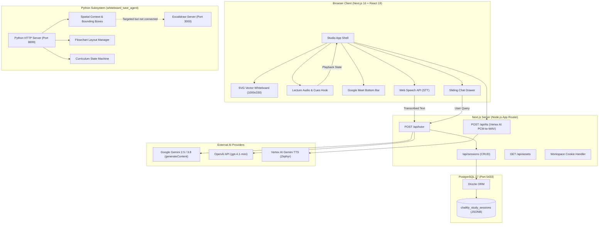

# Qrie Codebase Audit: Architecture, Gaps & Risks

> **Audit Date:** November 20, 2026 (Historical Baseline)  
> **Status Note:** This document represents the initial pre-implementation audit baseline. All 10 implementation phases (Canvas Intelligence Core, Asset Preparation Pipeline, Spatial Flowcharts, Student Doubt Interruption, Curriculum Engine, AI Teaching Orchestrator, Duplex Voice, LAM, and Performance Hardening) have since been completed and verified. For authoritative current architectural specifications, refer to [docs/MASTER_ARCHITECTURE.md](docs/MASTER_ARCHITECTURE.md), [docs/CLASS_AND_TUTOR_ARCHITECTURE.md](docs/CLASS_AND_TUTOR_ARCHITECTURE.md), and [FINAL_PROJECT_COMPLETION_REPORT.md](FINAL_PROJECT_COMPLETION_REPORT.md).

---

## 1. Existing System Architecture Overview

The current repository contains two decoupled subsystems:



---

## 2. Comprehensive Architectural Gap Analysis

### Gap 1: Disconnection Between Next.js Whiteboard and Python Spatial Agent
- **The Issue:** The repository contains an advanced spatial awareness engine ([`whiteboard_tutor_agent/spatial_context.py`](file:///home/vscode-gcp/projects/qrie_tutors/test06/ai-whiteboard-tutor-platform%20(1)/whiteboard_tutor_agent/spatial_context.py)), a semantic element tracker ([`whiteboard_tutor_agent/semantic_element.py`](file:///home/vscode-gcp/projects/qrie_tutors/test06/ai-whiteboard-tutor-platform%20(1)/whiteboard_tutor_agent/semantic_element.py)), and an automatic flowchart layout engine ([`whiteboard_tutor_agent/flowchart_manager.py`](file:///home/vscode-gcp/projects/qrie_tutors/test06/ai-whiteboard-tutor-platform%20(1)/whiteboard_tutor_agent/flowchart_manager.py)) with 60 passing unit tests. However, it targets an external Excalidraw server on port 3000 (`requests.delete("http://127.0.0.1:3000/api/elements/clear")`). The web frontend, in contrast, uses its own SVG vector whiteboard with a simple 2-column layout prompt.
- **Why It Matters:** The web app currently relies on the LLM to approximate coordinates ($x=45 \dots 945, y=30 \dots 300$), occasionally resulting in overlapping text or awkward positioning. Meanwhile, a rock-solid, test-verified spatial arithmetic engine already sits dormant in the same repository.
- **Remedy:** Port the geometric algorithms from `spatial_context.py` and `flowchart_manager.py` into TypeScript under `src/lib/spatial/` so the Next.js whiteboard can compute deterministic bounding boxes, collision avoidance, and flowchart diagrams.

### Gap 2: Lack of Duplex Voice Streaming & Continuous VAD
- **The Issue:** The documentation and `.env` cite `GEMINI_MODEL=gemini-3.8-live` and Gemini 3.8 Live API. However, the runtime code ([`src/lib/tutor.ts#L255-L270`](file:///home/vscode-gcp/projects/qrie_tutors/test06/ai-whiteboard-tutor-platform%20(1)/src/lib/tutor.ts#L255-L270)) actually executes standard HTTP REST POST requests to `:generateContent`. Line 307 explicitly states:
  ```ts
  if (vertexRes.status === 400 && /not supported in the generateContent API/i.test(...)) {
    throw new TutorError(`“${model}” is a Live API model, so it cannot answer whiteboard turns...`, 400);
  }
  ```
  Furthermore, voice input relies on the browser's Web Speech API (`webkitSpeechRecognition`), requiring manual mic clicks and a 1.7-second post-speech silence timeout.
- **Why It Matters:** True duplex voice (barge-in interruption, immediate conversational responsiveness without button clicking, continuous streaming audio) cannot be achieved through browser STT -> HTTP POST -> TTS roundtrips.
- **Remedy:** Implement a WebSockets proxy route (`/api/live-ws`) connecting to the Gemini Multimodal Live API (`ws://...BidiGenerateContent`) for real-time duplex voice and audio streaming.

### Gap 3: Missing Hierarchical Curriculum (Subject -> Chapter -> Topic) in Web Platform
- **The Issue:** In [`src/components/Dialogs.tsx#L42-L52`](file:///home/vscode-gcp/projects/qrie_tutors/test06/ai-whiteboard-tutor-platform%20(1)/src/components/Dialogs.tsx#L42-L52), "New Session" displays an open text box ("What would you like to learn?") and a flat grid of 8 guided lesson buttons. There is no structured Subject -> Chapter -> Topic hierarchy.
- **Why It Matters:** The agreed Qrie concept requires students to select their subject, chapter, and exact topic so that mandatory learning objectives, prerequisite formulas, and pre-built diagram assets can be collected before teaching starts.
- **Remedy:** Build a formal Curriculum Taxonomy schema and interactive 3-step selector (Subject -> Chapter -> Topic) linked to predefined asset bundles and learning objectives.

### Gap 4: Monolithic Single-Table JSONB Database Architecture
- **The Issue:** In [`src/db/schema.ts`](file:///home/vscode-gcp/projects/qrie_tutors/test06/ai-whiteboard-tutor-platform%20(1)/src/db/schema.ts), only one table exists: `chalkly_study_sessions`. All pages, marks, student ink, messages, suggestions, and quizzes are packed into a single `data` JSONB column.
- **Why It Matters:**
  1. *Write Amplification:* Every student pen stroke or tutor message rewires and serializes the entire session JSON object, which can exceed 500 KB per session.
  2. *Query Inefficiency:* It is impossible to query student performance across topics, aggregate quiz scores, or track concept mastery without parsing thousands of monolithic JSON blobs.
  3. *Concurrency Conflicts:* Simultaneous updates (e.g. background TTS saving audio while student writes on the whiteboard) risk overwriting each other.
- **Remedy:** Migrate to a normalized relational schema: `workspaces`, `sessions`, `board_pages`, `board_marks`, `chat_messages`, and `lam_mastery`.

### Gap 5: Absence of Learner Adaptive Model (LAM) & Mastery State
- **The Issue:** There is currently zero code tracking student learning history, mastery levels, misconception patterns, or retention across sessions.
- **Why It Matters:** A key pillar of the Qrie technical architecture is adapting the lesson sequence to the student's mastery level and retaining memory of their weaknesses. Currently, each session starts with zero pedagogical context about the student.
- **Remedy:** Implement a `LearnerAdaptiveModel` (LAM) service that tracks concept comprehension scores (0–100%), updates them based on quiz answers and question depth, and injects this mastery profile into the AI tutor's system prompt.

### Gap 6: Authentication & Multi-Tenancy Deficit
- **The Issue:** The platform relies exclusively on an unauthenticated, unsigned cookie (`chalkly_workspace`) generated by `crypto.randomUUID()` ([`src/lib/store.ts#L9-L16`](file:///home/vscode-gcp/projects/qrie_tutors/test06/ai-whiteboard-tutor-platform%20(1)/src/lib/store.ts#L9-L16)).
- **Why It Matters:** Any user clearing their browser cookies loses their entire workspace and saved boards permanently. Students cannot log in from a tablet and resume work started on a laptop. There is no user isolation or access control.
- **Remedy:** Integrate standard session-based or token-based authentication (e.g. NextAuth / Auth.js) with support for student profiles and multi-device workspace sync.

### Gap 7: Missing Asset Pre-rendering Pipeline
- **The Issue:** Diagram assets in `public/assets/` are loaded statically as raw SVGs or PNGs. When a dynamic class begins, vector annotations (arrows, callouts, spotlights) are computed on-the-fly during the turn.
- **Why It Matters:** Pre-rendering visual assets before the student enters the classroom ensures instant diagram transitions without waiting for LLM stroke generation during live teaching.
- **Remedy:** Create a Content & Asset Preparation Engine that pre-renders vector layers and region landmarks during the "Preparing lesson..." loading state.

### Gap 8: Broken Demo Audio Asset (`heart-diagram-v2.mp3`)
- **The Issue:** `heart-diagram` is registered in `src/lib/class-scripts.json` with 4 complete scenes, narration scripts, and diagram annotations, but the corresponding audio file `heart-diagram-v2.mp3` is missing from `public/class-audio/`.
- **Why It Matters:** The Heart Diagram demo lecture currently fails to play studio audio and falls back to browser speech synthesis.
- **Remedy:** Generate and commit `public/class-audio/heart-diagram-v2.mp3` using the TTS pipeline.

---

## 3. Security, Performance & Scalability Risk Matrix

| Risk Category | Severity | Description | Mitigation Strategy |
|---|---|---|---|
| **API Key Exposure** | **High** | Clients can supply raw API keys in HTTP headers (`x-gemini-key`, `x-openai-key`) which are transmitted over unencrypted connections if HTTPS is not enforced. | Restrict key storage to server-side encrypted secrets; use server-managed credentials exclusively. |
| **Workspace Cookie Hijacking** | **Medium** | `chalkly_workspace` is an unsigned UUID stored in an HTTP-only cookie. If an attacker guesses or steals the UUID, they gain full read/write access to all saved boards. | Sign cookies with an HMAC secret (`SESSION_SECRET`) and bind sessions to authenticated user IDs. |
| **PostgreSQL Write Amplification** | **High** | Each whiteboard auto-save writes the entire JSONB tree to disk. With 1,974 sessions in the database, frequent ink autosaves will degrade I/O performance under concurrent load. | Normalize `board_marks` and debounce canvas stroke sync using operational transforms or binary delta patches. |
| **Speech Recognition Fragmentation** | **Medium** | Web Speech API is only reliably implemented in Chromium-based browsers (Chrome, Edge). Firefox and Safari desktop often fail or produce empty transcripts. | Provide server-side Whisper STT fallback via Web Audio API recording. |
| **LLM Rate Limits & Quotas** | **Medium** | Gemini 2.5 Flash / 3.8 calls can fail with 429 Resource Exhausted or 402 Prepayment credits depleted during peak classroom usage. | Implement exponential backoff, request queuing, and seamless fallback to guided lesson scripts. |
| **DOM Element Explosion** | **Low** | Whiteboards with hundreds of strokes render individual `<path>` SVG nodes. Extremely complex freehand drawings can cause SVG DOM lag. | Merge contiguous freehand strokes into unified SVG path `d` strings and utilize canvas rasterization for static background layers. |
