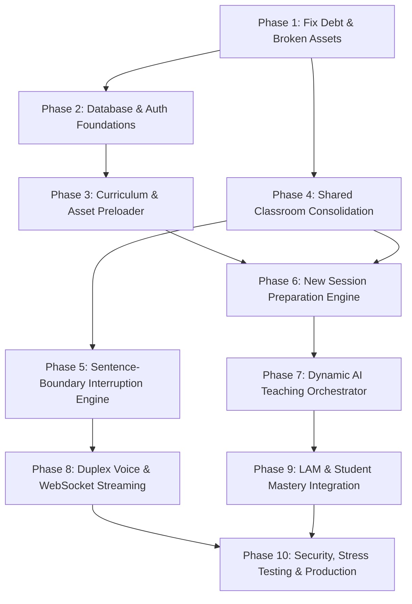

# Qrie Implementation Roadmap: Sequential Engineering Plan (Historical)

> **Historical Implementation Roadmap:** November 20, 2026  
> **Status:** FULLY COMPLETED across all 10 roadmap phases. See [FINAL_PROJECT_COMPLETION_REPORT.md](FINAL_PROJECT_COMPLETION_REPORT.md), [docs/MASTER_ARCHITECTURE.md](docs/MASTER_ARCHITECTURE.md), and [docs/BOOST_MODE_AND_PERFORMANCE.md](docs/BOOST_MODE_AND_PERFORMANCE.md).  
> **Target System:** Qrie AI Classroom (Hybrid, Asset-Prepared, Dynamically AI-Led)  
> **Execution Strategy:** Sequential, dependency-aware phases. Do not rebuild working modules.

---

## 1. Roadmap Architecture & Dependency Graph

---

## 2. Phase-by-Phase Task Breakdown

### Phase 1: Fix Existing Bugs & Technical Debt
*Goal: Ensure 100% baseline health across all existing assets, tests, and dependencies before introducing new features.*

| Field | Detail |
|---|---|
| **Priority** | **Critical** |
| **Task 1.1** | **Generate & Commit Missing Demo Audio Asset (`heart-diagram-v2.mp3`)** |
| **Current state** | `class-scripts.json` and `recorded-classes.ts` define the Heart Diagram lecture, but `public/class-audio/heart-diagram-v2.mp3` does not exist, causing audio error fallback. |
| **Required changes** | Synthesize the 4-scene narration from `class-scripts.json` for `heart-diagram` using the TTS pipeline ([`scripts/build-class-audio.py`](file:///home/vscode-gcp/projects/qrie_tutors/test06/ai-whiteboard-tutor-platform%20(1)/scripts/build-class-audio.py)) and commit `heart-diagram-v2.mp3` to `public/class-audio/`. |
| **Files/modules** | [`public/class-audio/heart-diagram-v2.mp3`](file:///home/vscode-gcp/projects/qrie_tutors/test06/ai-whiteboard-tutor-platform%20(1)/public/class-audio/), [`scripts/build-class-audio.py`](file:///home/vscode-gcp/projects/qrie_tutors/test06/ai-whiteboard-tutor-platform%20(1)/scripts/build-class-audio.py) |
| **Dependencies** | None. |
| **Acceptance criteria** | Opening "Heart Anatomy" demo lecture plays high-fidelity audio synchronized with heartbeat/valve cues without triggering `onAudioError`. |
| **Tests** | `npx playwright test tests/studio.spec.ts` |

| Field | Detail |
|---|---|
| **Priority** | **High** |
| **Task 1.2** | **Fix Python Benchmark Suite Package Resolution** |
| **Current state** | Running `python3 whiteboard_tutor_agent/feature_audit_test.py` fails with `ModuleNotFoundError: No module named 'whiteboard_tutor_agent'` unless `PYTHONPATH=.` is prefixed. |
| **Required changes** | Add dynamic `sys.path.insert(0, ...)` resolution to `feature_audit_test.py` and `server.py` to allow direct execution. |
| **Files/modules** | [`whiteboard_tutor_agent/feature_audit_test.py`](file:///home/vscode-gcp/projects/qrie_tutors/test06/ai-whiteboard-tutor-platform%20(1)/whiteboard_tutor_agent/feature_audit_test.py#L1-L20), [`whiteboard_tutor_agent/server.py`](file:///home/vscode-gcp/projects/qrie_tutors/test06/ai-whiteboard-tutor-platform%20(1)/whiteboard_tutor_agent/server.py#L1-L25) |
| **Dependencies** | None. |
| **Acceptance criteria** | `python3 whiteboard_tutor_agent/feature_audit_test.py` executes without import errors. |
| **Tests** | `python3 whiteboard_tutor_agent/feature_audit_test.py` |

---

### Phase 2: Complete Foundational Architecture
*Goal: Provide robust data persistence, relational normalization, and authenticated user workspaces.*

| Field | Detail |
|---|---|
| **Priority** | **High** |
| **Task 2.1** | **Relational Schema Migration for PostgreSQL** |
| **Current state** | Single table `chalkly_study_sessions` with all session data stored in a single monolithic JSONB column. |
| **Required changes** | Define normalized Drizzle schema: `workspaces`, `sessions`, `board_pages`, `board_marks`, and `chat_messages`. Write migration script in Drizzle Kit. Maintain backwards compatibility with legacy JSONB rows. |
| **Files/modules** | [`src/db/schema.ts`](file:///home/vscode-gcp/projects/qrie_tutors/test06/ai-whiteboard-tutor-platform%20(1)/src/db/schema.ts), [`drizzle.config.ts`](file:///home/vscode-gcp/projects/qrie_tutors/test06/ai-whiteboard-tutor-platform%20(1)/drizzle.config.ts), [`src/lib/store.ts`](file:///home/vscode-gcp/projects/qrie_tutors/test06/ai-whiteboard-tutor-platform%20(1)/src/lib/store.ts) |
| **Dependencies** | Phase 1. |
| **Acceptance criteria** | Creating, updating, and saving sessions executes granular SQL inserts/updates instead of full JSONB serialization. |
| **Tests** | Drizzle migration check; `npm run typecheck`; Playwright persistence tests. |

| Field | Detail |
|---|---|
| **Priority** | **Medium** |
| **Task 2.2** | **Student Authentication & Workspace Binding** |
| **Current state** | Anonymous UUID cookie `chalkly_workspace`. |
| **Required changes** | Implement lightweight session-based authentication (supporting guest sessions with persistent upgrade). Secure cookies with HMAC signing. |
| **Files/modules** | [`src/lib/store.ts`](file:///home/vscode-gcp/projects/qrie_tutors/test06/ai-whiteboard-tutor-platform%20(1)/src/lib/store.ts#L9-L16), [`src/components/Dialogs.tsx`](file:///home/vscode-gcp/projects/qrie_tutors/test06/ai-whiteboard-tutor-platform%20(1)/src/components/Dialogs.tsx) |
| **Dependencies** | Task 2.1. |
| **Acceptance criteria** | Students can sign in across devices and access their saved boards and learning history. |
| **Tests** | Auth unit tests; cookie tampering security tests. |

---

### Phase 3: Curriculum & Asset Preloader Engine
*Goal: Implement the Subject -> Chapter -> Topic hierarchical data model and asset preloading pipeline.*

| Field | Detail |
|---|---|
| **Priority** | **Critical** |
| **Task 3.1** | **Hierarchical Curriculum Database & Taxonomy** |
| **Current state** | Flat catalog of 8 guided lessons in `lessons.ts`; Python curriculum has 3 topics in `curriculum.py`. |
| **Required changes** | Build unified Curriculum Taxonomy in TypeScript: `Subject` (Physics, Biology, Math, Chemistry) -> `Chapter` -> `Topic`. Each topic defines mandatory concepts, required diagrams from `/assets`, and learning outcomes. |
| **Files/modules** | `src/lib/curriculum/taxonomy.ts`, `src/lib/curriculum/types.ts`, [`src/lib/lessons.ts`](file:///home/vscode-gcp/projects/qrie_tutors/test06/ai-whiteboard-tutor-platform%20(1)/src/lib/lessons.ts) |
| **Dependencies** | Phase 2. |
| **Acceptance criteria** | Querying a topic returns its syllabus metadata, mandatory concepts, and associated diagram asset IDs. |
| **Tests** | Unit tests for taxonomy validation and asset link integrity. |

| Field | Detail |
|---|---|
| **Priority** | **High** |
| **Task 3.2** | **Asset Preparation Engine (Pre-rendering & Region Verification)** |
| **Current state** | Diagrams loaded statically from `assets-manifest.json` without pre-rendering visual overlays. |
| **Required changes** | Create preloader service that loads the topic's diagram asset, pre-calculates anatomical regions in board coordinates ($x, y, w, h$), and pre-renders vector highlight boundaries before class entry. |
| **Files/modules** | `src/lib/curriculum/asset-preloader.ts`, [`src/lib/assets.ts`](file:///home/vscode-gcp/projects/qrie_tutors/test06/ai-whiteboard-tutor-platform%20(1)/src/lib/assets.ts), [`src/lib/annotate.ts`](file:///home/vscode-gcp/projects/qrie_tutors/test06/ai-whiteboard-tutor-platform%20(1)/src/lib/annotate.ts) |
| **Dependencies** | Task 3.1. |
| **Acceptance criteria** | Starting a class prepares visual resources and generates a cached classroom context in $< 200\text{ms}$. |
| **Tests** | Unit tests verifying that asset coordinates match target diagram landmarks. |

---

### Phase 4: Shared Classroom Consolidation
*Goal: Unify the SVG Web Whiteboard with the Python spatial arithmetic and flowchart generation algorithms.*

| Field | Detail |
|---|---|
| **Priority** | **High** |
| **Task 4.1** | **Port Spatial Context & Flowchart Manager to TypeScript** |
| **Current state** | Spatial bounding-box math and flowchart edge-routing are implemented in Python (`spatial_context.py`, `flowchart_manager.py`) targeting Excalidraw. |
| **Required changes** | Port `SpatialContext`, `BoundingBox`, and `FlowchartManager` to TypeScript (`src/lib/spatial/`). Connect them directly to `Whiteboard.tsx` vector mark generators. |
| **Files/modules** | `src/lib/spatial/context.ts`, `src/lib/spatial/flowchart.ts`, [`src/components/Whiteboard.tsx`](file:///home/vscode-gcp/projects/qrie_tutors/test06/ai-whiteboard-tutor-platform%20(1)/src/components/Whiteboard.tsx) |
| **Dependencies** | None (can run in parallel with Phase 2). |
| **Acceptance criteria** | AI tutor can draw multi-step algorithm flowcharts and relative elements (`below`, `beside`, `inside`) with zero bounding-box overlaps on the SVG whiteboard. |
| **Tests** | Port all 60 Python unit tests to TypeScript Playwright unit tests. |

| Field | Detail |
|---|---|
| **Priority** | **Medium** |
| **Task 4.2** | **Screen Sharing / WebRTC Presentation Mode** |
| **Current state** | "Present now" button in `GoogleMeetBar.tsx` toggles local state flag `presenting`. |
| **Required changes** | Wire `navigator.mediaDevices.getDisplayMedia()` to capture student screen if requested, rendering student shared screen as an interactive board backdrop. |
| **Files/modules** | [`src/components/GoogleMeetBar.tsx`](file:///home/vscode-gcp/projects/qrie_tutors/test06/ai-whiteboard-tutor-platform%20(1)/src/components/GoogleMeetBar.tsx#L145-L160), [`src/components/Studio.tsx`](file:///home/vscode-gcp/projects/qrie_tutors/test06/ai-whiteboard-tutor-platform%20(1)/src/components/Studio.tsx) |
| **Dependencies** | Phase 1. |
| **Acceptance criteria** | Clicking "Present now" prompts for screen capture and overlays presentation stream onto whiteboard layout. |
| **Tests** | Browser permission mock tests in Playwright. |

---

### Phase 5: Demo Lectures & Sentence-Boundary Interruption
*Goal: Perfect the Demo Lecture experience with sentence-level interruption handling and seamless playback resumption.*

| Field | Detail |
|---|---|
| **Priority** | **Critical** |
| **Task 5.1** | **Sentence-Boundary Graceful Pause Engine** |
| **Current state** | Raising hand pauses audio immediately, potentially cutting off the tutor in the middle of a syllable. |
| **Required changes** | Parse cue narration sentences. When a student raises a hand or speaks: continue playing audio until the current sentence ends (within 0.5–1.5s), gracefully fade out volume, pause at sentence end, and transition to Doubt-Solving Mode. |
| **Files/modules** | [`src/components/useClassPlayback.ts`](file:///home/vscode-gcp/projects/qrie_tutors/test06/ai-whiteboard-tutor-platform%20(1)/src/components/useClassPlayback.ts#L110-L150), [`src/components/Studio.tsx`](file:///home/vscode-gcp/projects/qrie_tutors/test06/ai-whiteboard-tutor-platform%20(1)/src/components/Studio.tsx#L445-L460) |
| **Dependencies** | Phase 1. |
| **Acceptance criteria** | Hand raise waits for sentence completion before pausing; audio fades smoothly. |
| **Tests** | Playwright test asserting audio pause occurs at a valid punctuation timestamp. |

| Field | Detail |
|---|---|
| **Priority** | **High** |
| **Task 5.2** | **Doubt Resolution Context Retention & Restoration** |
| **Current state** | Floating `.meet-doubt-banner` allows resuming lecture. AI answers using `lectureContext`. |
| **Required changes** | When doubt is answered: store tutor doubt sketches on an ephemeral doubt layer (`page.doubtMarks`). When student clicks "Resume lecture", smoothly archive doubt annotations, restore the paused scene drawing, and continue playback from `pausedTimestamp`. |
| **Files/modules** | [`src/components/Studio.tsx`](file:///home/vscode-gcp/projects/qrie_tutors/test06/ai-whiteboard-tutor-platform%20(1)/src/components/Studio.tsx#L585-L605), [`src/components/Whiteboard.tsx`](file:///home/vscode-gcp/projects/qrie_tutors/test06/ai-whiteboard-tutor-platform%20(1)/src/components/Whiteboard.tsx) |
| **Dependencies** | Task 5.1. |
| **Acceptance criteria** | Resuming lecture cleanly restores the prerecorded board state without residue from doubt illustrations. |
| **Tests** | E2E Playwright test simulating hand raise, doubt question, and lecture resumption. |

---

### Phase 6: New Session Preparation & Content Loading
*Goal: Implement the 3-step live class setup modal and asset preparation workflow.*

| Field | Detail |
|---|---|
| **Priority** | **Critical** |
| **Task 6.1** | **Hierarchical 3-Step New Session Modal (Subject -> Chapter -> Topic)** |
| **Current state** | Flat guided buttons + open text input in `NewSessionDialog`. |
| **Required changes** | Replace `NewSessionDialog` with a 3-step interactive wizard: Step 1 (Select Subject), Step 2 (Select Chapter), Step 3 (Select Topic). Provide search filter and custom topic override option. |
| **Files/modules** | [`src/components/Dialogs.tsx`](file:///home/vscode-gcp/projects/qrie_tutors/test06/ai-whiteboard-tutor-platform%20(1)/src/components/Dialogs.tsx#L42-L52), `src/components/CurriculumPicker.tsx` |
| **Dependencies** | Phase 3. |
| **Acceptance criteria** | Selecting Subject -> Chapter -> Topic packages syllabus requirements and opens the prepared classroom. |
| **Tests** | Playwright UI component tests for 3-step selection flow. |

| Field | Detail |
|---|---|
| **Priority** | **High** |
| **Task 6.2** | **Prepared Classroom Context Compilation** |
| **Current state** | Session created with empty pages or static preset. |
| **Required changes** | When New Session is submitted: compile `ClassroomContext` containing mandatory concepts, learning objectives, diagram asset with region IDs, student level, and preferred language. Pass this context into the initial tutor turn. |
| **Files/modules** | [`src/app/api/sessions/route.ts`](file:///home/vscode-gcp/projects/qrie_tutors/test06/ai-whiteboard-tutor-platform%20(1)/src/app/api/sessions/route.ts), [`src/lib/tutor.ts`](file:///home/vscode-gcp/projects/qrie_tutors/test06/ai-whiteboard-tutor-platform%20(1)/src/lib/tutor.ts) |
| **Dependencies** | Task 6.1, Task 3.2. |
| **Acceptance criteria** | Initial whiteboard load instantly displays the preloaded diagram with labeled regions and lesson objectives. |
| **Tests** | API route integration tests. |

---

### Phase 7: Dynamic AI Teaching Orchestrator
*Goal: Enable the AI tutor to dynamically control pedagogy, sequencing, demonstrations, and pacing.*

| Field | Detail |
|---|---|
| **Priority** | **Critical** |
| **Task 7.1** | **Multi-Turn Pedagogical State Machine** |
| **Current state** | Single-turn request/response loop; AI responds directly to prompts without a multi-stage teaching plan. |
| **Required changes** | Implement pedagogical state machine in `src/lib/pedagogy/`: Stages: `1_INTRODUCE` -> `2_VISUAL_DEMO` -> `3_CHECKPOINT_QUESTION` -> `4_EVALUATE_AND_REMEDIATE` -> `5_SYNTHESIS`. AI enforces covering mandatory concepts while freely choosing explanation style and pacing. |
| **Files/modules** | `src/lib/pedagogy/state-machine.ts`, [`src/lib/tutor.ts`](file:///home/vscode-gcp/projects/qrie_tutors/test06/ai-whiteboard-tutor-platform%20(1)/src/lib/tutor.ts#L64-L85), [`src/app/api/tutor/route.ts`](file:///home/vscode-gcp/projects/qrie_tutors/test06/ai-whiteboard-tutor-platform%20(1)/src/app/api/tutor/route.ts) |
| **Dependencies** | Phase 6. |
| **Acceptance criteria** | Tutor guides student through progressive stages, asking checkpoint questions and refusing to conclude until mandatory concepts are covered. |
| **Tests** | Unit tests verifying stage transitions and mandatory concept validation. |

| Field | Detail |
|---|---|
| **Priority** | **High** |
| **Task 7.2** | **Dynamic Persona & Communication Style Adapter** |
| **Current state** | Static prompt: "You are Chalkly, a patient, accurate visual tutor...". |
| **Required changes** | Allow dynamic persona adaptation (Encouraging Mentor, Socratic Inquirer, Rigorous Professor, Friendly Peer) based on student grade level and preferred teaching style. |
| **Files/modules** | [`src/lib/tutor.ts`](file:///home/vscode-gcp/projects/qrie_tutors/test06/ai-whiteboard-tutor-platform%20(1)/src/lib/tutor.ts#L64-L85), [`src/components/Dialogs.tsx`](file:///home/vscode-gcp/projects/qrie_tutors/test06/ai-whiteboard-tutor-platform%20(1)/src/components/Dialogs.tsx) |
| **Dependencies** | Task 7.1. |
| **Acceptance criteria** | Prompt dynamically modifies tone, vocabulary, and analogies to match selected persona. |
| **Tests** | Prompt snapshot testing for different personas. |

---

### Phase 8: Duplex Voice & WebSocket Streaming
*Goal: Implement continuous hands-free voice interaction and low-latency audio streaming.*

| Field | Detail |
|---|---|
| **Priority** | **High** |
| **Task 8.1** | **Continuous Client-Side Voice Activity Detection (VAD)** |
| **Current state** | Manual mic button click required; browser stops listening after short phrase. |
| **Required changes** | Integrate lightweight WebAssembly VAD (e.g. `@ricky0123/vad-web` or Silero VAD) to continuously monitor student microphone. When student speaks: automatically mute tutor audio, activate captions, and stream speech. |
| **Files/modules** | `src/components/useVAD.ts`, [`src/components/Studio.tsx`](file:///home/vscode-gcp/projects/qrie_tutors/test06/ai-whiteboard-tutor-platform%20(1)/src/components/Studio.tsx#L295-L330) |
| **Dependencies** | Phase 5. |
| **Acceptance criteria** | Student speaking automatically pauses lecture or tutor explanation without touching mouse or keyboard. |
| **Tests** | Web Audio API mock tests for speech start/end events. |

| Field | Detail |
|---|---|
| **Priority** | **Medium** |
| **Task 8.2** | **Gemini Multimodal Live API WebSocket Proxy** |
| **Current state** | HTTP REST POST to `:generateContent`. |
| **Required changes** | Build WebSocket route `/api/live-ws` connecting to Gemini Live API (`BidiGenerateContent`), enabling streaming bidirectional PCM audio and real-time tool calling. |
| **Files/modules** | `src/app/api/live-ws/route.ts`, `src/lib/gemini-live-client.ts` |
| **Dependencies** | Task 8.1. |
| **Acceptance criteria** | Voice roundtrip latency $< 800\text{ms}$ with full-duplex conversational barge-in. |
| **Tests** | WebSocket mock integration tests. |

---

### Phase 9: LAM (Learner Adaptive Model) Integration
*Goal: Persist student understanding, track knowledge progression, and adapt future teaching.*

| Field | Detail |
|---|---|
| **Priority** | **High** |
| **Task 9.1** | **Learner Mastery Database Schema & Service** |
| **Current state** | No student knowledge tracking. |
| **Required changes** | Create `lam_student_mastery` table: `student_id`, `concept_id`, `mastery_score` (0.00–1.00), `attempt_count`, `last_reviewed_at`, `misconceptions` (JSONB array). Build LAM evaluation service. |
| **Files/modules** | `src/db/schema.ts`, `src/lib/lam/service.ts`, `src/lib/lam/evaluator.ts` |
| **Dependencies** | Phase 2, Phase 7. |
| **Acceptance criteria** | Checkpoint answers automatically update concept mastery scores and log specific misconceptions. |
| **Tests** | Unit tests for Bayesian knowledge tracing or mastery score decay. |

| Field | Detail |
|---|---|
| **Priority** | **Medium** |
| **Task 9.2** | **Pedagogical Feedback Loop into AI Tutor** |
| **Current state** | System prompt only sees last 12 chat messages. |
| **Required changes** | Inject student's LAM mastery profile and identified misconceptions into the system prompt. If mastery is low: tutor automatically provides simpler analogies and visual scaffolding. |
| **Files/modules** | [`src/lib/tutor.ts`](file:///home/vscode-gcp/projects/qrie_tutors/test06/ai-whiteboard-tutor-platform%20(1)/src/lib/tutor.ts#L64-L85), `src/lib/lam/service.ts` |
| **Dependencies** | Task 9.1. |
| **Acceptance criteria** | Tutor references student's previous misconceptions and alters explanation depth based on mastery score. |
| **Tests** | E2E test verifying pedagogical adaptation based on simulated low-mastery state. |

---

### Phase 10: Security, Stress Testing & Production Readiness
*Goal: Enterprise-grade reliability, security hardening, and performance optimization.*

| Field | Detail |
|---|---|
| **Priority** | **High** |
| **Task 10.1** | **Security Hardening (API Key Isolation & CSP)** |
| **Current state** | Client headers can pass raw API keys; CSP headers are not enforced. |
| **Required changes** | Eliminate client-side API key forwarding; require server-side secret management. Implement strict Content Security Policy (CSP) for WebSockets, Web Audio, and SVG rendering. |
| **Files/modules** | [`src/app/api/tutor/route.ts`](file:///home/vscode-gcp/projects/qrie_tutors/test06/ai-whiteboard-tutor-platform%20(1)/src/app/api/tutor/route.ts), [`next.config.ts`](file:///home/vscode-gcp/projects/qrie_tutors/test06/ai-whiteboard-tutor-platform%20(1)/next.config.ts) |
| **Dependencies** | Phase 2. |
| **Acceptance criteria** | No sensitive credentials visible in client network traffic; strict CSP blocks unauthorized scripts. |
| **Tests** | Security audit scripts; Playwright header checks. |

| Field | Detail |
|---|---|
| **Priority** | **Medium** |
| **Task 10.2** | **Performance & Concurrency Stress Testing** |
| **Current state** | Tested with single-user Playwright suite. |
| **Required changes** | Execute load tests simulating 50 concurrent students streaming voice and receiving whiteboard vector updates. Optimize PostgreSQL connection pool and vector stroke compression. |
| **Files/modules** | `tests/stress/load-test.ts`, [`src/db/index.ts`](file:///home/vscode-gcp/projects/qrie_tutors/test06/ai-whiteboard-tutor-platform%20(1)/src/db/index.ts) |
| **Dependencies** | All prior phases. |
| **Acceptance criteria** | Server maintains $< 300\text{ms}$ median API latency and $< 1\%\text{ packet drop}$ under 50 concurrent streams. |
| **Tests** | K6 or Playwright concurrent worker load test suite. |
