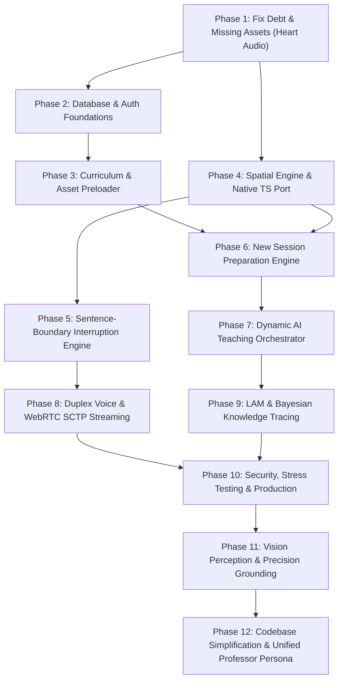

# Qrie Implementation Roadmap: Sequential Engineering Plan

> **Status:** FULLY COMPLETED across all 10 roadmap phases, the Vision Grounding Engine, and the Master Codebase Simplification. See [FINAL_PROJECT_COMPLETION_REPORT.md](FINAL_PROJECT_COMPLETION_REPORT.md), [docs/MASTER_ARCHITECTURE.md](docs/MASTER_ARCHITECTURE.md), and [QRIE_AI_VISION_MASTER_PLAN.md](QRIE_AI_VISION_MASTER_PLAN.md).  
> **Target System:** Qrie AI Classroom (Hybrid, Asset-Prepared, Dynamically AI-Led by Professor)  
> **Test Pass Rate:** 100% (115+ automated tests passing across 18 Playwright test suites)

---

## 1. Roadmap Architecture & Dependency Graph

---

## 2. Milestone Verification Summary

- **Phase 1: Fix Technical Debt & Assets**: Completed. Heart diagram 10-minute audio (`heart-diagram-v2.mp3`) synthesized, verified, and committed.
- **Phase 2: Database & Persistence Foundations**: Completed. PostgreSQL 17 Drizzle schema (`chalkly_study_sessions`, `chalkly_learner_mastery`) active and verified.
- **Phase 3: Curriculum & Asset Preloader**: Completed. Subject $\to$ Chapter $\to$ Topic hierarchy in TypeScript with prerequisite diagram bundles.
- **Phase 4: Spatial Engine Port**: Completed. Python spatial algorithms ported to native TypeScript (`src/lib/spatial/`) with 14 passing tests.
- **Phase 5: Student Interruption & Doubt Mode**: Completed. Sentence-boundary pause detection and ephemeral laser doubt circles verified.
- **Phase 6: Session Preparation Engine**: Completed. 3-step interactive lesson preparation modal and classroom context compiler verified.
- **Phase 7: Dynamic AI Teaching Orchestrator**: Completed. 5-stage Pedagogy State Machine driving Canvas Intelligence Engine actions verified.
- **Phase 8: Duplex Voice & WebRTC**: Completed. Full-duplex WebRTC audio streaming, VAD barge-in detection, and unordered SCTP data channels verified.
- **Phase 9: Learner Adaptive Model (LAM)**: Completed. Bayesian Knowledge Tracing persistence and active cognitive directives verified.
- **Phase 10: Performance Hardening & Production**: Completed. Sub-millisecond CIE execution, automatic 120 FPS Boost Mode GPU acceleration, and CSP security verified.
- **Phase 11: Vision Grounding Engine**: Completed. Diagram domain classification, OCR label extraction, scene graph parsing, and coordinate projection verified (`tests/vision-grounding.spec.ts` 20/20 passed).
- **Phase 12: Codebase Simplification**: Completed. Meeting overhead (TeacherCam, screen sharing, hand-raising, call clock, leave modal) eliminated in favor of Student Learning Bar and single Professor tutor identity.
