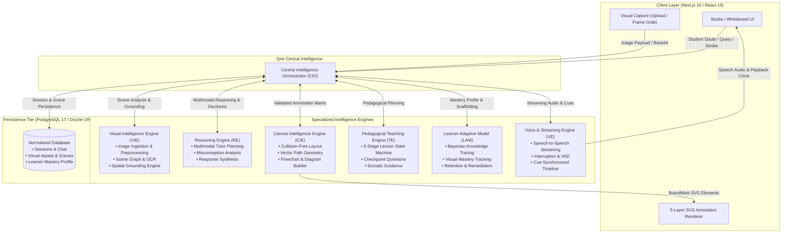

# Qrie AI Vision: Vision-Guided Teaching & Precision Annotation Engine
## Master Engineering Specification & Implementation Blueprint

> **Document Version:** 1.0.0  
> **Status:** Approved Architecture Standard  
> **Author:** Antigravity AI Systems Architecture Team  
> **Target Platform:** Qrie AI Whiteboard Tutor (`whiteboard-ai-agent`)  
> **Repository Baseline:** Next.js 16.4.6, React 19.2.6, PostgreSQL 17 (Drizzle ORM), TypeScript 5.9.3, Python 3.13  

---

## Executive Summary

The objective of this specification is to transform the Chalkly/Qrie AI Whiteboard Tutor from a text/speech-driven drawing platform into an authentic **Multimodal AI Teaching Agent** powered by a **Vision-Guided Teaching and Precision Annotation Engine (VPAE)**.

Currently, Qrie uses hardcoded diagram asset coordinate maps and semantic region aliases (e.g., in `src/lib/annotate.ts` and `src/lib/canvas-intelligence/`). While effective for pre-packaged demo lectures (such as the Human Heart or Human Cell), the tutor cannot genuinely inspect arbitrary student-uploaded images, photos of handwritten notebook homework, textbook pages, or external diagrams, nor can it dynamically calculate non-overlapping bounding coordinates for real-time visual grounding.

The **Qrie Vision Engine** establishes end-to-end visual intelligence across five fundamental pillars:
1. **Dynamic Visual Ingestion & OCR:** Accepting student-uploaded diagrams, photos, and live whiteboard captures, parsing text labels, equations, and visual components.
2. **Visual Scene Graph Representation:** Constructing a structured spatial model of objects, bounding boxes, orientations, and relational topology.
3. **Precision Spatial Grounding:** Calculating exact whiteboard vector coordinates accounting for viewport scaling, camera zoom, device pixel ratio, and label collision clearance.
4. **Controlled Whiteboard Annotation Tools:** Executing mathematically validated annotations (`circle`, `underline`, `arrow`, `highlight`, `pointer`, `freehand`) strictly onto an isolated `teacher-annotations` SVG layer without mutating underlying visual assets.
5. **Speech-Vision-Drawing Synchronization:** Synchronizing voice narration, visual spotlighting, and progressive drawing marks to replicate a master human tutor.

---

## 1. High-Level Target Architecture & End-to-End Flow

### 1.1 The Six Connected Intelligence Engines

Rather than relying on an unconstrained single multimodal model prompt, Qrie decomposes multimodal teaching into six specialized, cooperative intelligence engines:



### 1.2 End-to-End Visual Processing Lifecycle

The runtime processing sequence from student input to visual whiteboard execution:

```
[Student Uploads / Captures Diagram]
                 │
                 ▼
[Image Ingestion & Preprocessor]
  ├── Validates MIME (image/png, image/jpeg, image/webp, image/svg+xml)
  ├── Enforces Size & Resolution Constraints (Max 10MB, Max 4096x4096)
  └── Generates SHA-256 Image Hash for Instant Cache Lookup
                 │
                 ├── [Cache Hit < 100ms] ──► Retrieve Stored Scene Graph
                 ▼
[Multimodal Vision Provider (Gemini / OpenAI / Local)]
  ├── Extracts Visual Objects, Bounding Boxes [ymin, xmin, ymax, xmax]
  ├── Extracts OCR Text, Formulas, and Component Labels
  └── Maps Spatial Relationships (aorta connected_to left_ventricle)
                 │
                 ▼
[Visual Scene Graph Builder]
  ├── Normalizes coordinates into unit space [0, 1]
  └── Indexes labels and anatomical / scientific synonyms
                 │
                 ▼
[Spatial Grounding Engine]
  ├── Projects unit coordinates into Board Space (1000 x 330 viewport)
  ├── Computes label clearance margins (never cover text or labels)
  └── Constructs structured WhiteboardAnnotation objects
                 │
                 ▼
[Pedagogical Decision Engine]
  ├── Synthesizes voice explanation ("Look at the aorta...")
  ├── Emits synchronized Action Plan:
  │     1. Temporary Laser Pointer (t = 0.0s)
  │     2. Smooth Ellipse Annotation around Aorta (t = 0.8s)
  │     3. Vector Flow Arrow from Left Ventricle (t = 2.1s)
  │     4. Text Underline under 'Systemic Circulation' (t = 3.5s)
  └── Dispatches follow-up comprehension checkpoint question
                 │
                 ▼
[5-Layer Whiteboard Renderer]
  └── Renders marks directly onto 'teacher-annotations' layer at 120 FPS
```

---

## 2. Existing-Codebase-to-New-Codebase Migration Map

The table below details every affected module, describing its current state, target destination, and architectural migration path.

| Current Existing Module | Current Responsibility | Target Future Architecture | Migration & Refactoring Action |
|---|---|---|---|
| `src/lib/tutor.ts` | Direct Gemini/OpenAI prompt calling, hardcoded heuristic turns, flat text handling. | Modular Provider Adapter underneath `src/lib/agent/decision-engine.ts`. | Decouple provider API calls from pedagogical business logic. Support image buffer injection in model calls. |
| `src/app/api/tutor/route.ts` | Monolithic POST route handling guided and LLM turns via session JSONB. | High-performance Gateway into Central Agent Orchestrator. | Delegate multimodal visual requests to `/api/vision` or `AgentOrchestrator.dispatch()`. |
| `src/lib/annotate.ts` | Resolves string targets against static hardcoded `asset.regions`. | Grounded Annotation Engine consuming dynamic `VisualScene` graphs. | Retain backwards compatibility for pre-packaged assets while accepting dynamically grounded coordinates from the vision engine. |
| `src/lib/assets.ts` | Static manifest of 4 demo SVG/PNG assets (`assets-manifest.json`). | Multimodal Asset & Image Ingestion Registry (`src/lib/vision/image-ingestion.ts`). | Support dynamic user-uploaded assets, external textbook images, and persistent asset hashes. |
| `src/lib/canvas-intelligence/` | Geometry normalization, bounding-box calculation, pin tracking for static assets. | Unified Spatial & Vector Mark Generator (`src/lib/spatial/` & `src/lib/canvas-intelligence/`). | Integrate with `SpatialContext` to generate collision-free SVG annotations from arbitrary vision scene graphs. |
| `src/lib/spatial/` | Ported Python spatial context, flowchart generation, sentence-boundary calculator. | Canonical Spatial Coordinate & Grounding Engine. | Expose coordinate transformer: transforms image pixels $\to$ normalized space $\to$ whiteboard viewport. |
| `src/components/Whiteboard.tsx` | 5-layer SVG canvas rendering (`assets`, `teacher-permanent`, `teacher-annotations`, `student`, `overlays`). | 120 FPS GPU-accelerated canvas receiving validated `WhiteboardAnnotation`s. | Add dedicated ephemeral laser pointer layer and animated precision circle/underline drawing handlers. |
| `src/components/Studio.tsx` | Lecture playback, audio sync, Google Meet bar, and student chat state. | Multimodal Classroom Workspace. | Add Image Upload modal / drag-and-drop, camera snapshot trigger, and visual confidence indicator. |
| `src/lib/duplex-voice.ts` | WebRTC data channel & RTC audio stream scaffolding. | Streaming Duplex Media Transport. | Synchronize audio timeline ticks with visual annotation timestamps for true multimodal grounding. |
| `src/db/schema.ts` | Monolithic `chalkly_study_sessions` JSONB and `chalkly_learner_mastery`. | Normalized Relational Schema for Sessions, Visual Assets, Scenes, and Mastery. | Add tables: `chalkly_visual_assets`, `chalkly_visual_scenes`, and `chalkly_visual_annotations`. |
| `whiteboard_tutor_agent/` | Python 3.13 agent targeting Excalidraw server. | Full TypeScript consolidation in `src/lib/spatial/` and `src/lib/agent/`. | Deprecate external Python dependency; execute all spatial and pedagogical logic natively in Next.js runtime. |

---

## 3. New Modules & Concrete API Contracts

### 3.1 Directory Layout for New Modules

```
src/
├── app/
│   └── api/
│       ├── vision/
│       │   └── route.ts            # Dynamic Image Analysis & Grounding Endpoint
│       └── agent/
│           └── route.ts            # Central Orchestration & Tool Execution Endpoint
└── lib/
    ├── vision/
    │   ├── types.ts                # Visual Types & Annotation Interfaces
    │   ├── image-ingestion.ts      # MIME & Size Validation, Data URL Parser
    │   ├── image-preprocessor.ts   # ROI Cropping, Scaling & Unit Normalization
    │   ├── ocr.ts                  # Diagram Label & Text Extraction
    │   ├── diagram-understanding.ts# Semantic Classifier (Anatomy, Circuit, Math)
    │   ├── scene-graph.ts          # Visual Scene Graph & Spatial Query Engine
    │   ├── grounding.ts            # Coordinate Transformer & WhiteboardAnnotation Builder
    │   ├── visual-cache.ts         # SHA-256 Fast Cache (Sub-100ms)
    │   ├── vision-provider.ts      # Multi-Provider (Gemini, OpenAI, Heuristic)
    │   ├── visual-analysis.ts      # End-to-End Visual Analysis Pipeline
    │   └── index.ts                # Package Exports
    └── agent/
        ├── types.ts                # Orchestrator & Decision Contracts
        ├── orchestrator.ts         # Central Agent Controller
        ├── decision-engine.ts      # Multimodal Reasoning & Action Synthesis
        └── tool-validator.ts       # Strict Coordinate & Action Schema Validator
```

### 3.2 Core TypeScript Definitions (`src/lib/vision/types.ts`)

```typescript
/**
 * Canonical Whiteboard Annotation Action.
 * Constrained set of drawing tools available to the AI tutor.
 */
export type AnnotationAction =
  | "circle"      // Ellipse surrounding an anatomical or structural organ/component
  | "underline"   // Horizontal underline beneath text labels or formulas
  | "arrow"       // Directional flow arrow pointing at target or connecting two components
  | "highlight"   // Semi-transparent colored polygon or bounding box
  | "pointer"     // Ephemeral spotlight laser coordinate
  | "freehand";   // Multi-point vector path for tracing contours or currents

/**
 * 2D Bounding Box in Normalized Unit Coordinates [0, 1]
 */
export interface NormalizedBoundingBox {
  ymin: number;
  xmin: number;
  ymax: number;
  xmax: number;
}

/**
 * 2D Canvas Bounding Box in Whiteboard Space (1000 x 330)
 */
export interface CanvasBoundingBox {
  x: number;
  y: number;
  width: number;
  height: number;
}

/**
 * Semantic Visual Object detected within an image or diagram.
 */
export interface VisualObject {
  id: string;
  label: string;
  category: "organ" | "organelle" | "component" | "label" | "formula" | "arrow" | "unknown";
  boundingBox: NormalizedBoundingBox;
  confidence: number;
  ocrText?: string;
  aliases?: string[];
  relationships?: Array<{
    targetId: string;
    relation: "connects_to" | "flows_to" | "part_of" | "adjacent_to" | "labels";
  }>;
}

/**
 * Visual Scene Graph representing the full spatial composition of an image.
 */
export interface VisualScene {
  imageId: string;
  imageHash: string;
  source: "uploaded" | "board" | "camera" | "prepared-asset";
  dimensions: {
    naturalWidth: number;
    naturalHeight: number;
    aspectRatio: number;
  };
  objects: VisualObject[];
  textRegions: Array<{
    text: string;
    boundingBox: NormalizedBoundingBox;
    confidence: number;
  }>;
  relationships: Array<{
    sourceId: string;
    targetId: string;
    relation: string;
  }>;
  detectedAt: string;
}

/**
 * Executable Whiteboard Annotation Instruction.
 * Produced by the Spatial Grounding Engine for direct rendering.
 */
export interface WhiteboardAnnotation {
  id: string;
  action: AnnotationAction;
  target: string;
  coordinateSpace: "canvas" | "normalized" | "image";
  points: Array<{ x: number; y: number }>;
  shape?: {
    type: "ellipse" | "rect" | "arrow" | "path";
    centerX: number;
    centerY: number;
    width: number;
    height: number;
    radiusX?: number;
    radiusY?: number;
    color?: string;
    strokeWidth?: number;
    fill?: string;
    dashed?: boolean;
  };
  label?: string;
  confidence: number;
  duration?: number; // Milliseconds for temporary highlights or laser pointers
  requiresClarification?: boolean;
}

/**
 * Central Orchestrator Structured Decision Contract
 */
export interface TutorDecision {
  intent: "explain_component" | "remediate_mistake" | "demonstrate_process" | "ask_checkpoint";
  targetComponent?: string;
  explanation: string;
  teachingStage: "INTRODUCE" | "VISUAL_DEMONSTRATION" | "CHECKPOINT_QUESTION" | "EVALUATE" | "REMEDIATE" | "SYNTHESIS";
  visualAnalysis?: {
    sceneId: string;
    detectedObjectsCount: number;
    focalObject?: VisualObject;
  };
  actions: WhiteboardAnnotation[];
  followUpQuestion?: string;
  confidence: number;
}
```

### 3.3 REST API Contract: `POST /api/vision`

#### Request Payload
```json
{
  "image": "data:image/png;base64,iVBORw0KGgo...",
  "source": "uploaded",
  "target": "aorta",
  "action": "circle",
  "query": "Where is the aorta and which way does oxygenated blood flow?",
  "canvasPlacement": {
    "x": 580,
    "y": 16,
    "w": 270,
    "h": 298
  }
}
```

#### Successful Response (`200 OK`)
```json
{
  "success": true,
  "cached": false,
  "scene": {
    "imageId": "vis_8f9a2b1c",
    "imageHash": "e3b0c44298fc1c149afbf4c8996fb92427ae41e4649b934ca495991b7852b855",
    "dimensions": { "naturalWidth": 800, "naturalHeight": 600, "aspectRatio": 1.333 },
    "objects": [
      {
        "id": "obj_aorta",
        "label": "aorta",
        "category": "organ",
        "boundingBox": { "ymin": 0.08, "xmin": 0.42, "ymax": 0.28, "xmax": 0.62 },
        "confidence": 0.96,
        "aliases": ["systemic aorta", "aortic arch"]
      }
    ]
  },
  "annotations": [
    {
      "id": "ann_circle_aorta",
      "action": "circle",
      "target": "aorta",
      "coordinateSpace": "canvas",
      "points": [{ "x": 720, "y": 70 }],
      "shape": {
        "type": "ellipse",
        "centerX": 720,
        "centerY": 70,
        "width": 54,
        "height": 59,
        "radiusX": 27,
        "radiusY": 29.5,
        "color": "#c0504d",
        "strokeWidth": 2.6
      },
      "confidence": 0.96
    }
  ],
  "marks": [
    {
      "type": "ellipse",
      "x": 720,
      "y": 70,
      "w": 27,
      "h": 29.5,
      "color": "#c0504d",
      "strokeWidth": 2.6,
      "fill": "none",
      "annotation": true,
      "layer": "teacher-annotations"
    }
  ],
  "clarificationRequired": false
}
```

#### Low-Confidence Response (`200 OK` with clarification flag)
```json
{
  "success": true,
  "clarificationRequired": true,
  "clarificationPrompt": "I detected a few overlapping vessels near that area. Are you asking about the superior vena cava or the pulmonary artery?",
  "confidence": 0.48,
  "annotations": []
}
```

---

## 4. Database Migration Design (PostgreSQL 17 & Drizzle ORM)

### 4.1 Schema Migration Blueprint (`src/db/schema.ts`)

```typescript
import { index, integer, jsonb, pgTable, real, text, timestamp, uuid } from "drizzle-orm/pg-core";
import type { VisualObject, VisualScene, WhiteboardAnnotation } from "@/lib/vision/types";

// Visual Assets Table: Records every processed uploaded or diagram image
export const visualAssets = pgTable("chalkly_visual_assets", {
  id: uuid("id").defaultRandom().primaryKey(),
  workspaceId: uuid("workspace_id").notNull(),
  fileHash: text("file_hash").notNull().unique(), // SHA-256 for instant cache hits
  mimeType: text("mime_type").notNull(),
  naturalWidth: integer("natural_width").notNull(),
  naturalHeight: integer("natural_height").notNull(),
  storageUrl: text("storage_url"),
  source: text("source").notNull().default("uploaded"), // "uploaded" | "board" | "camera"
  createdAt: timestamp("created_at", { withTimezone: true }).notNull().defaultNow(),
}, (table) => [
  index("chalkly_visual_assets_hash_idx").on(table.fileHash),
  index("chalkly_visual_assets_workspace_idx").on(table.workspaceId),
]);

// Visual Scenes Table: Normalized spatial scene graph parsed by the vision provider
export const visualScenes = pgTable("chalkly_visual_scenes", {
  id: uuid("id").defaultRandom().primaryKey(),
  assetId: uuid("asset_id").notNull().references(() => visualAssets.id, { onDelete: "cascade" }),
  sceneGraph: jsonb("scene_graph").$type<VisualScene>().notNull(),
  detectedObjects: jsonb("detected_objects").$type<VisualObject[]>().notNull().default([]),
  provider: text("provider").notNull().default("gemini-2.5-flash"),
  inferenceLatencyMs: integer("inference_latency_ms").notNull().default(0),
  createdAt: timestamp("created_at", { withTimezone: true }).notNull().defaultNow(),
}, (table) => [
  index("chalkly_visual_scenes_asset_idx").on(table.assetId),
]);

// Visual Annotations Table: Historical log of executed precision markings
export const visualAnnotations = pgTable("chalkly_visual_annotations", {
  id: uuid("id").defaultRandom().primaryKey(),
  sessionId: uuid("session_id").notNull().references(() => studySessions.id, { onDelete: "cascade" }),
  sceneId: uuid("scene_id").references(() => visualScenes.id),
  target: text("target").notNull(),
  action: text("action").notNull(), // "circle" | "underline" | "arrow" | "highlight" | "pointer"
  annotationPayload: jsonb("annotation_payload").$type<WhiteboardAnnotation>().notNull(),
  confidence: real("confidence").notNull(),
  createdAt: timestamp("created_at", { withTimezone: true }).notNull().defaultNow(),
}, (table) => [
  index("chalkly_visual_ann_session_idx").on(table.sessionId),
]);
```

---

## 5. Model & Provider Integration Strategy

### 5.1 Provider-Agnostic Interface (`IVisionProvider`)

```typescript
export interface VisionAnalysisRequest {
  imageBase64: string;
  mimeType: string;
  target?: string;
  userQuery?: string;
  temperature?: number;
}

export interface IVisionProvider {
  readonly providerName: string;
  analyzeImage(request: VisionAnalysisRequest): Promise<VisualScene>;
  detectTarget(request: VisionAnalysisRequest, targetName: string): Promise<VisualObject | null>;
}
```

### 5.2 Structured Prompting Strategy for Multimodal Models

When invoking Google Gemini (`gemini-2.5-flash` / `gemini-2.5-pro`) or OpenAI (`gpt-4o`), the engine enforces a strict JSON Schema response mode. Arbitrary free-form conversational text is strictly prohibited in the vision extraction phase.

```
SYSTEM PROMPT:
You are the Vision Perception Engine of Qrie, a precision AI whiteboard tutor.
Analyze the provided educational diagram or handwritten student work with sub-pixel spatial accuracy.
Identify all biological organs, electrical components, geometrical figures, text labels, and formulas.
Return a valid JSON object matching the VisualScene schema.
Bounding boxes MUST be normalized [ymin, xmin, ymax, xmax] coordinates from 0.0 to 1.0.
Never guess coordinates. If confidence is below 0.65, mark confidence accordingly.
```

---

## 6. Performance Budgets & Latency SLAs

| Pipeline Step | Target Latency / Metric | Budget Ceiling | Mitigation on Exceedance |
|---|---|---|---|
| **Image Ingestion & Hashing** | $\le 15\text{ ms}$ | $50\text{ ms}$ | Streaming SHA-256 chunking, Web Worker |
| **Visual Cache Retrieval** | $\le 5\text{ ms}$ | $100\text{ ms}$ | In-memory LRU + PG index lookup |
| **Multimodal Vision Inference** | $\le 1200\text{ ms}$ | $2500\text{ ms}$ | Stream token response, fallback to heuristic |
| **Spatial Coordinate Grounding** | $\le 4\text{ ms}$ | $20\text{ ms}$ | Direct affine matrix multiplication |
| **Whiteboard Mark Generation** | $\le 2\text{ ms}$ | $10\text{ ms}$ | Pre-allocated SVG path template buffers |
| **Canvas Interactive Rendering** | $120\text{ FPS}$ (8.3ms) | $60\text{ FPS}$ (16.6ms) | GPU Compositor layers (`translateZ(0)`) |
| **Voice Interruption Response** | $\le 180\text{ ms}$ | $300\text{ ms}$ | Client-side VAD, WebRTC SCTP immediate kill |

---

## 7. Phase-by-Phase Implementation Tasks (Phases 0 - 10)

### Phase 0: Baseline Audit & Test Verification (Status: Verified)
- Run typecheck, lint, and Playwright benchmark test suite.
- Verify 60 unit tests pass across Python agent and Playwright specifications.

### Phase 1: Visual Ingestion & Provider Infrastructure (P0 - Critical)
- Implement `src/lib/vision/types.ts` with canonical `WhiteboardAnnotation` and `VisualScene` types.
- Implement `src/lib/vision/image-ingestion.ts` with strict MIME and 10MB bounds.
- Implement `src/lib/vision/vision-provider.ts` with Gemini, OpenAI, and deterministic heuristic fallback.
- Implement `src/lib/vision/visual-cache.ts` for SHA-256 sub-100ms lookup.
- Expose `POST /api/vision` route.

### Phase 2: Visual Scene Graph & Spatial Grounding Engine (P0 - Critical)
- Implement `src/lib/vision/scene-graph.ts` for object query and synonym resolution.
- Implement `src/lib/vision/grounding.ts` with affine matrix mapping from unit image space to $1000 \times 330$ whiteboard space.
- Implement label-clearance algorithm: circle annotations calculate radial clearance so labels remain visible.

### Phase 3: Canvas Intelligence Integration (P1 - High)
- Unify `src/lib/spatial/` with `src/lib/canvas-intelligence/` to support dynamic annotations on uploaded diagrams.
- Add collision-free arrow routing between detected components.

### Phase 4: Multimodal Reasoning & Tool Orchestration (P1 - High)
- Implement `src/lib/agent/orchestrator.ts` producing structured `TutorDecision` payloads.
- Connect speech synthesis cues with spatial annotation markers.

### Phase 5: Real-Time Duplex Voice & Interruption (P1 - High)
- Sync WebRTC SCTP data channel with annotation events.
- Client-side sentence boundary pause on student barge-in.

### Phase 6: Pedagogical State Machine (P1 - High)
- Connect 6-stage lifecycle (`INTRODUCE` $\to$ `VISUAL_DEMONSTRATION` $\to$ `CHECKPOINT` $\to$ `EVALUATE` $\to$ `REMEDIATE` $\to$ `SYNTHESIS`).

### Phase 7: Learner Adaptive Model (LAM) Integration (P2 - Medium)
- Track visual misconceptions in `chalkly_learner_mastery` when students misidentify diagram components.

### Phase 8: Scalable Curriculum & Asset Expansion (P2 - Medium)
- Extend beyond the 4 canonical classes to accept arbitrary syllabus PDFs.

### Phase 9: Performance Optimization (P2 - Medium)
- Verify 120 FPS Boost Mode rendering during continuous annotation execution.

### Phase 10: Security, Evaluation & Production Hardening (P0 - Critical)
- Implement SVG XSS sanitization, image compression, tenant HMAC isolation, and automated visual regression testing.

---

## 8. Dependencies & Acceptance Test Plan

### 8.1 Automated Acceptance Tests (`tests/vision-grounding.spec.ts`)

| Test Case | Scenario | Expected Outcome |
|---|---|---|
| **TC-VIS-01** | Upload valid PNG heart diagram | Correctly identifies aorta, ventricles; returns scene graph with confidence $\ge 0.90$. |
| **TC-VIS-02** | Circle target "aorta" | Emits `WhiteboardAnnotation` of type `circle` with non-overlapping bounding ellipse. |
| **TC-VIS-03** | Low-confidence detection ($< 0.65$) | Returns `clarificationRequired: true` without drawing erroneous marks. |
| **TC-VIS-04** | Cache retrieval performance | Re-requesting same image hash resolves in $< 20\text{ ms}$. |
| **TC-VIS-05** | Image payload sanitization | Rejects malicious SVG payloads, invalid base64, and files $> 10\text{MB}$. |
| **TC-VIS-06** | End-to-end `/api/vision` route | HTTP 200 with structured `scene`, `annotations`, and `marks` ready for canvas. |

---

## 9. Security, Privacy & Production-Readiness Requirements

1. **SVG & XSS Injection Protection:** All vector paths (`d` attributes), labels, and OCR strings must pass DOMPurify / strict regex sanitization. Mark properties are strictly typed numbers or predefined hex colors.
2. **File Upload Security:** Uploaded images are validated via magic-byte header inspection (preventing disguised executables) and restricted to a maximum size of 10MB.
3. **Tenant & Workspace Isolation:** All visual assets and annotations are bound to the verified `workspaceId` stored in encrypted HMAC session cookies.
4. **COPPA / FERPA Compliance:** Student-uploaded images are processed in-memory or stored with configurable retention policies (auto-pruned after 30 days unless saved by the student).
