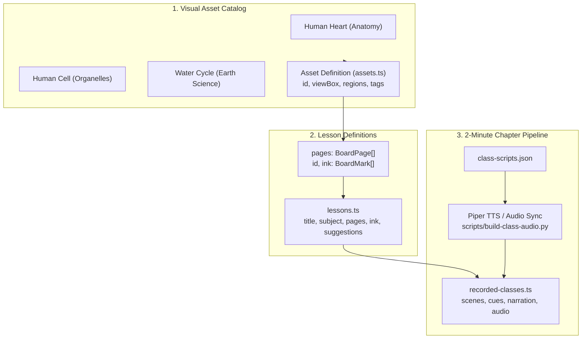
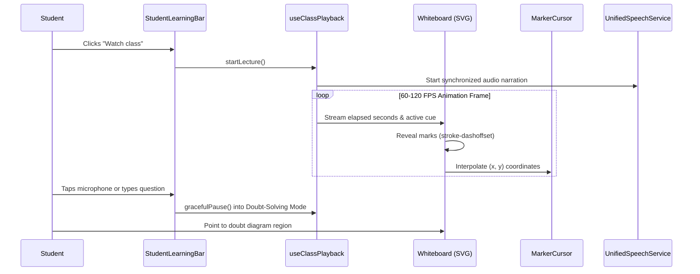
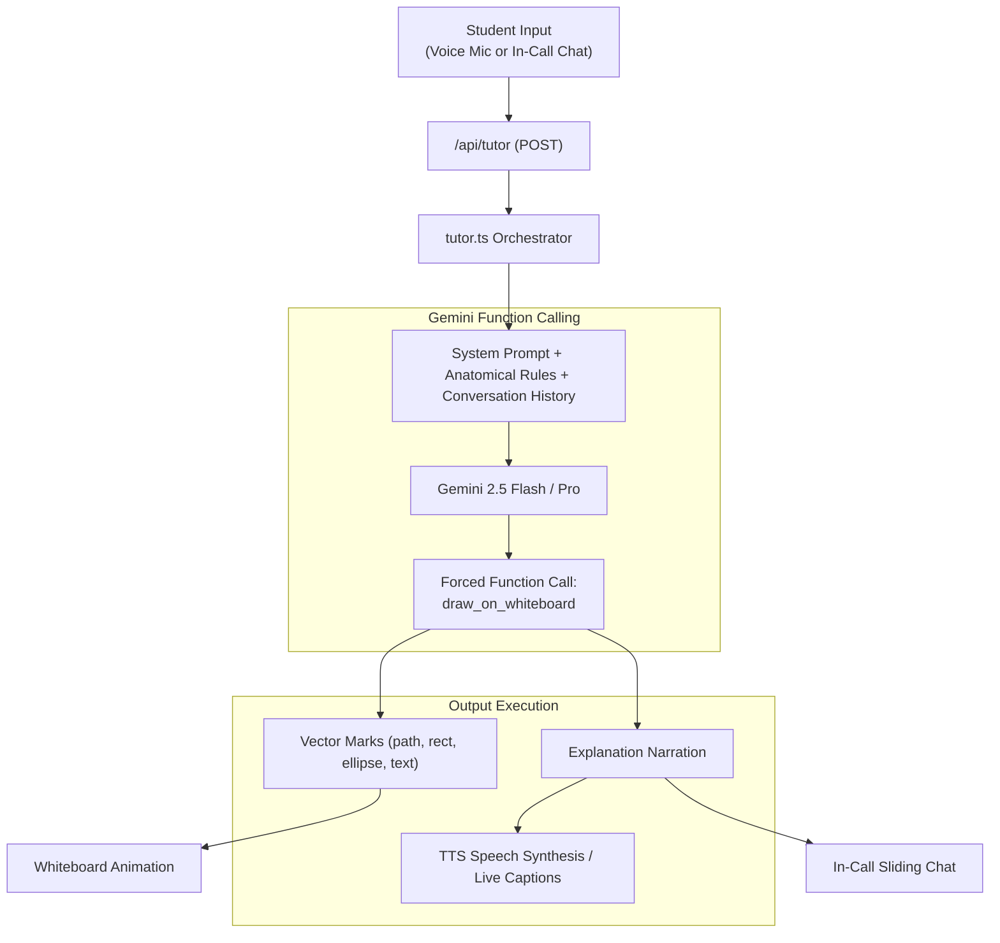

# Chalkly — Class Engine & AI Tutor Architecture

This document provides a comprehensive technical guide to how classes are created, how the playback engine renders them on the whiteboard, how the AI tutor interacts with students, and how each component operates within the Google Meet-style studio environment.

---

## 1. How Classes Are Made

Classes in Chalkly are constructed using a structured data pipeline that combines visual diagram assets, vector annotations, and cue-timed narrations.



### A. The Diagram Asset Catalog (`src/lib/assets.ts`)
Visual lessons (e.g., Human Heart, Human Cell, Water Cycle) start in the asset catalog:
- **Vector Assets**: SVG diagrams placed inside `public/assets/`.
- **Region Callouts**: Pre-mapped bounding coordinates and anatomical landmarks (e.g., Superior Vena Cava, Right Atrium, Tricuspid Valve, Left Ventricle, Aorta).
- **Guided Annotation Rules**: Specific coordinate formulas allowing the AI model or recorded script to anchor labels, highlight loops, and draw arrows directly to parts of the organ or cell without obscuring other features.

### B. Lesson Definitions (`src/lib/lessons.ts`)
Each learning session is initialized with:
- `id` & `lessonKey`: Unique identifier.
- `title` & `subject`: e.g., *"Human Heart Anatomy"*, *"Pythagorean theorem"*, *"Understanding fractions"*, *"The Human Cell"*.
- `pages`: An array of `BoardPage` objects holding the base ink (vector paths, rectangles, ellipses, text, and diagram images).
- `suggestions`: Topic-specific quick questions (e.g., *"Show me an example"*, *"Quiz me"*, *"Explain blood flow"*).
- `recordingInk`: Dedicated storage for notes taken during class playback.

### C. 2-Minute 4-Chapter Structure (`src/lib/recorded-classes.ts`)
Each class is split into four 30-second chapters totaling 120 seconds:
1. **Chapter 1: The Core Foundation (0:00–0:28)**: Introduces the core diagram, orientation, and fundamental principles.
2. **Chapter 2: Step-by-Step Demonstration (0:28–1:02)**: The tutor draws dynamic vector marks, tracing flow paths, calculations, or anatomical structures.
3. **Chapter 3: Interactive Challenge / "Your Turn" (1:02–1:36)**: An interactive problem is posed on the board with a cue-aligned pause asking the student to solve it before the tutor continues.
4. **Chapter 4: Summary & Solution Reveal (1:36–2:00)**: The worked answer is demonstrated, key principles are reinforced, and study notes are unlocked.

---

## 2. How Classes Work in the Studio

The playback engine synchronizes audio narration with high-performance SVG canvas rendering at 60 FPS.



### A. Sub-Millisecond Audio Clock Synchronization
- Managed by `src/components/useClassPlayback.ts`.
- Reads `HTMLAudioElement.currentTime` inside a `requestAnimationFrame` loop.
- **Fail-Safe Offline Playback**: If the audio file cannot be loaded or network fails, an internal clock takes over, ensuring board drawings, marker movement, and subtitles continue playing seamlessly.

### B. Cue-Based Stroke Interpolation (`drawingAtCue`)
At any given millisecond `t`:
- `drawingAtCue(cues, t)` calculates which marks should be rendered and where the teacher's pen should point.
- The marker pen (`.marker-cursor`) moves using GPU-accelerated CSS transforms (`translate3d`), preventing layout shifts or repaints.
- Completed marks are memoized, so only the actively drawn mark is updated on each frame.

### C. Independent Ink Layering
- **Tutor Ink** (`visibleMarks`): Controlled by the lesson timeline or AI tool calls.
- **Student Ink** (`page.ink`): Preserved separately in private session state. The student can draw, write text annotations, insert shapes, and erase their own work without modifying the tutor's demonstration.

### D. Boost Mode & 120 FPS GPU Compositing
- Applied via `.boost-mode-active` on the `.board-card` container.
- Hardware-accelerates the 5-layer SVG stack with `contain: layout paint` and `transform: translateZ(0)`.
- Eliminates layout shifts, cursor teleportation glitches, and ghost marks when seeking or switching classes.
- Controllable via Google Meet Bar (`Zap` button), topbar, `Ctrl + B` keyboard shortcut, or `/boost` in the chat drawer. (See [docs/BOOST_MODE_AND_PERFORMANCE.md](BOOST_MODE_AND_PERFORMANCE.md)).

---

## 3. How the AI Tutor Interacts

The AI Tutor answers questions, solves problems, and creates custom lessons dynamically using Gemini models.



### A. Forced Function Calling (`draw_on_whiteboard`)
- The tutor does not just return markdown text. Requests sent to `/api/tutor` use Gemini's function calling mode set to `"ANY"`.
- The model **must** invoke the `draw_on_whiteboard` tool with:
  - `explanation`: Spoken narration explaining the step.
  - `marks`: Vector commands (`type: "path" | "rect" | "ellipse" | "text" | "image"`, coordinates, stroke sizes, colors).
  - `suggestions`: 2–3 follow-up question chips.

### B. Multilingual Capabilities
The tutor supports three language modes configured in **Settings**:
1. **English (`en`)**: Formal academic instruction.
2. **Hinglish (`hinglish`)**: Natural conversational Indian teaching style using Romanized Hindi and English (e.g., *"Deoxygenated blood Vena Cava ke through Right Atrium mein enter karta hai"*).
3. **Hindi (`hi`)**: Devanagari script for both spoken explanation and whiteboard vector text annotations.

### C. Voice Interaction Loop
1. **Mic Toggle**: Clicking the microphone in the Google Meet control bar activates browser Web Speech Recognition.
2. **Live Transcriptions**: Spoken words appear in real time in the captions overlay.
3. **Audio Synthesis**: The tutor's reply is spoken aloud via browser Web Speech Synthesis or synthetic audio while the whiteboard animates the solution.

---

## 4. Google Meet Studio Architecture

The studio provides a video-meeting environment styled after Google Meet:

```
+-----------------------------------------------------------------------------------+
| Topbar: Navigation / Breadcrumbs / Session Save Status / Gemini Status Strip      |
+-----------------------------------------------------------------------------------+
|                                                                                   |
|  WHITEBOARD CANVAS (Maximized Viewport Height)                                   |
|                                                                                   |
|  [Tutor Participant Tile]                                                         |
|  - Animated TeacherCam                                                            |
|  - Active Speaker Green Outline                                                   |
|  - "AI Tutor" Tag + Audio Waves                                                   |
|  - Toggled ON/OFF via Camera button                                               |
|                                                                                   |
|  [Drawing Toolbar: Pen, Eraser, Rect, Ellipse, Text, Image Assets, Colors]         |
|                                                                                   |
+-----------------------------------------------------------------------------------+
| Live Captions Overlay (Centered Subtitles: Student & Tutor speech)               |
+-----------------------------------------------------------------------------------+
| GOOGLE MEET BOTTOM CONTROL BAR (#202124)                                          |
| [12:00 PM | Lesson Title]  [Mic] [Cam] [CC] [Hand] [Present] [Leave]  [Info] [Chat]  |
+-----------------------------------------------------------------------------------+
                                                                   |
                                          (Toggles from right) --> | [In-Call Messages]
                                                                   | - Call Disclaimer
                                                                   | - Message History
                                                                   | - Thinking Dots
                                                                   | - Question Chips
                                                                   | - Chat Composer
```

### Key UI Components
- **Student Learning Bar** (`src/components/GoogleMeetBar.tsx`):
  - **Left**: Active lesson or chapter title.
  - **Center**: Clean, dark rounded pill buttons:
    - **Chapter Navigation**: Previous chapter, Play/Pause lecture, Next chapter, Exit lecture.
    - **Mic**: Toggles speech listening (`Ctrl + d` / `M`) with live VAD meter. Instantly pauses lecture into Doubt-Solving Mode.
    - **Captions (`c`)**: Toggles real-time closed captions.
    - **Playback Speed**: Cycles narration speed across 0.75x, 1x, 1.25x, 1.5x, and 2x.
  - **Right**: One-click toggle for the Unified Conversation Transcript & Discussion Panel.
- **Unified Whiteboard Stage** (`src/components/Whiteboard.tsx`):
  - Distraction-free, responsive SVG canvas with GPU-accelerated drawing and marker animation.
- **SlidingChatPanel** (`src/components/SlidingChatPanel.tsx`):
  - Unified chronological transcript containing lecture narration, student questions, and Professor explanations.
- **LiveCaptionsOverlay** (`src/components/LiveCaptionsOverlay.tsx`):
  - Centered floating banner above the bottom control bar displaying live speech transcripts with "Professor:" tags.
