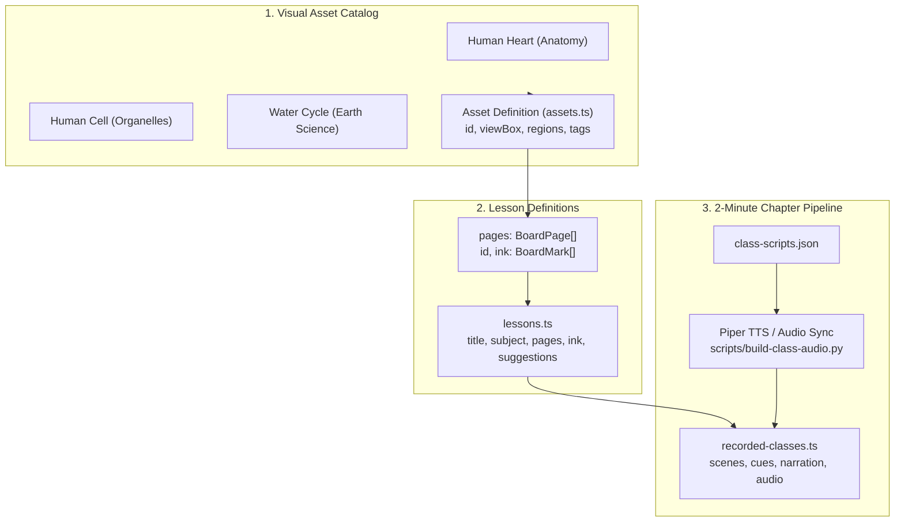
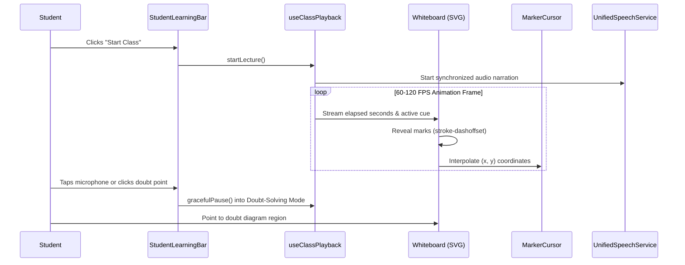
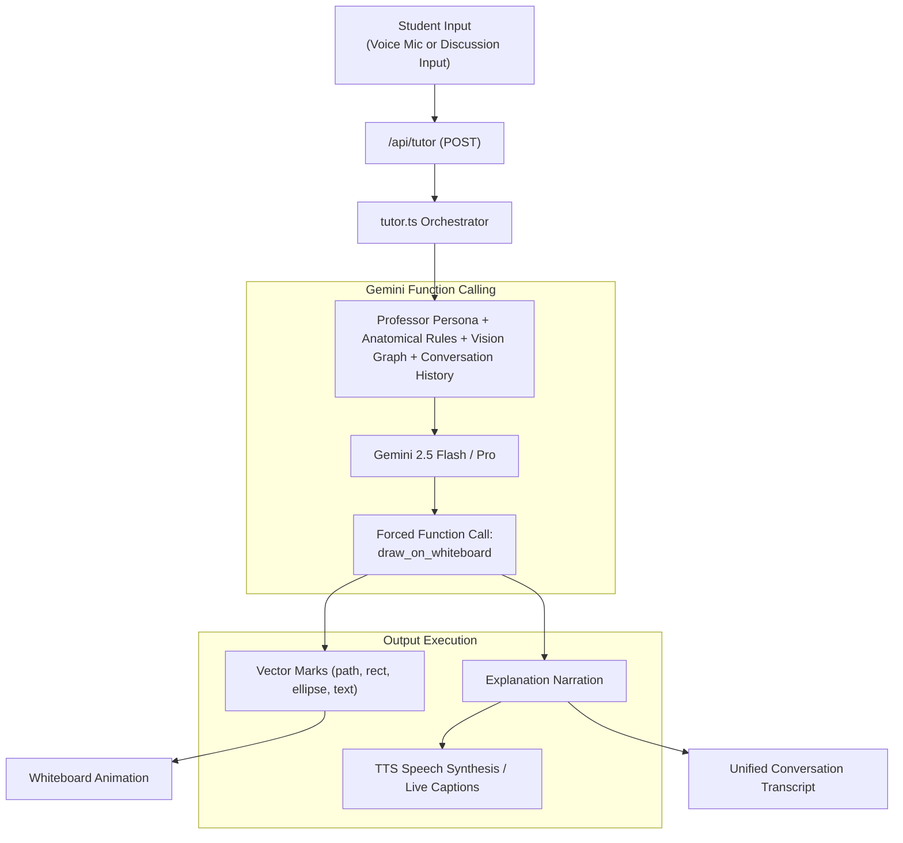

# Qrie — Class Engine & AI Tutor Architecture

This document provides a comprehensive technical guide to how classes are created, how the playback engine renders them on the whiteboard, how the AI tutor interacts with students, and how each component operates within the focused student learning studio.

---

## 1. How Classes Are Made

Classes in Qrie are constructed using a structured data pipeline that combines visual diagram assets, vector annotations, and cue-timed narrations.



### A. The Diagram Asset Catalog (`src/lib/assets.ts`)
Visual lessons (e.g., Human Heart, Human Cell, Water Cycle) start in the asset catalog:
- **Vector Assets**: SVG diagrams placed inside `public/assets/`.
- **Region Callouts**: Pre-mapped bounding coordinates and anatomical landmarks (e.g., Superior Vena Cava, Right Atrium, Tricuspid Valve, Left Ventricle, Aorta).
- **Guided Annotation Rules**: Specific coordinate formulas allowing the AI model or recorded script to anchor labels, highlight loops, and draw arrows directly to parts of the organ or cell without obscuring other features.

### B. Lesson Definitions (`src/lib/lessons.ts`)
Each learning session is initialized with:
- `id` & `lessonKey`: Unique identifier.
- `title` & `subject`: e.g., *"Human Heart Anatomy"*, *"Pythagorean theorem"*, *"Understanding fractions"*, *"The Human Cell"*.
- `pages`: An array of `BoardPage` objects holding the base ink (vector paths, rectangles, ellipses, text, and diagram images).
- `suggestions`: Topic-specific quick questions (e.g., *"Show me an example"*, *"Quiz me"*, *"Explain blood flow"*).
- `recordingInk`: Dedicated storage for notes taken during class playback.

### C. 2-Minute 4-Chapter Structure (`src/lib/recorded-classes.ts`)
Each class is split into four 30-second chapters totaling 120 seconds:
1. **Chapter 1: The Core Foundation (0:00–0:28)**: Introduces the core diagram, orientation, and fundamental principles.
2. **Chapter 2: Step-by-Step Demonstration (0:28–1:02)**: The tutor draws dynamic vector marks, tracing flow paths, calculations, or anatomical structures.
3. **Chapter 3: Interactive Challenge / "Your Turn" (1:02–1:36)**: An interactive problem is posed on the board with a cue-aligned pause asking the student to solve it before the tutor continues.
4. **Chapter 4: Summary & Solution Reveal (1:36–2:00)**: The worked answer is demonstrated, key principles are reinforced, and study notes are unlocked.

---

## 2. How Classes Work in the Studio

The playback engine synchronizes audio narration with high-performance SVG canvas rendering at 60–120 FPS.



### A. Sub-Millisecond Audio Clock Synchronization
- Managed by `src/components/useClassPlayback.ts`.
- Reads `HTMLAudioElement.currentTime` inside a `requestAnimationFrame` loop.
- **Fail-Safe Offline Playback**: If the audio file cannot be loaded or network fails, an internal clock takes over, ensuring board drawings, marker movement, and subtitles continue playing seamlessly.

### B. Cue-Based Stroke Interpolation (`drawingAtCue`)
At any given millisecond `t`:
- `drawingAtCue(cues, t)` calculates which marks should be rendered and where the teacher's pen should point.
- The marker pen (`.marker-cursor`) moves using GPU-accelerated CSS transforms (`translate3d`), preventing layout shifts or repaints.
- Completed marks are memoized, so only the actively drawn mark is updated on each frame.

### C. Independent Ink Layering
- **Tutor Ink** (`visibleMarks`): Controlled by the lesson timeline or AI tool calls.
- **Student Ink** (`page.ink`): Preserved separately in private session state. The student can draw, write text annotations, insert shapes, and erase their own work without modifying the tutor's demonstration.

### D. Boost Mode & 120 FPS GPU Compositing
- Applied via `.boost-mode-active` on the `.board-card` container (`data-boost-mode="true"`).
- Hardware-accelerates the 5-layer SVG stack with `contain: layout paint` and `transform: translateZ(0)`.
- Eliminates layout shifts, cursor teleportation glitches, and ghost marks when seeking or switching classes.
- Operates automatically in the background, with optional `Ctrl + B` keyboard shortcut or `/boost` chat command. (See [docs/BOOST_MODE_AND_PERFORMANCE.md](BOOST_MODE_AND_PERFORMANCE.md)).

---

## 3. How the AI Tutor Interacts

The AI Tutor answers questions, solves problems, and creates custom lessons dynamically using Gemini models under the single persona: **Professor**.



### A. Forced Function Calling (`draw_on_whiteboard`)
- The tutor does not just return markdown text. Requests sent to `/api/tutor` use Gemini's function calling mode set to `"ANY"`.
- The model **must** invoke the `draw_on_whiteboard` tool with:
  - `explanation`: Spoken narration explaining the step.
  - `marks`: Vector commands (`type: "path" | "rect" | "ellipse" | "text" | "image"`, coordinates, stroke sizes, colors).
  - `suggestions`: 2–3 follow-up question chips.

### B. Multilingual Capabilities
The tutor supports three language modes configured in **Settings**:
1. **English (`en`)**: Formal academic instruction.
2. **Hinglish (`hinglish`)**: Natural conversational Indian teaching style using Romanized Hindi and English (e.g., *"Deoxygenated blood Vena Cava ke through Right Atrium mein enter karta hai"*).
3. **Hindi (`hi`)**: Devanagari script for both spoken explanation and whiteboard vector text annotations.

### C. Voice Interaction Loop & Doubt Resolution
1. **Mic Toggle & Interruption**: Clicking the microphone in the student control bar activates browser Web Speech Recognition and VAD, pausing the lecture into Doubt-Solving Mode.
2. **Query Resolver Topic Relevance Verification Matrix (`isQuestionRelevantToTopic`)**:
   - In `src/lib/curriculum-answers.ts` and `src/app/api/tutor/route.ts`, the student's question is passed through a multi-dimensional relevance matrix evaluating:
     - **Active Lesson Scope**: Topic name, chapter title, syllabus progression, recap/preview concepts.
     - **On-Screen Diagram & Visual Elements**: Recognizes questions about diagram elements, borders, colors, numbers, bullet points, arrows, organelle structures, and labels.
     - **Dynamic Mark & Region Extraction**: Inspects live SVG marks (`currentMarks`) and semantic diagram regions (`currentRegions`) so newly introduced terms or labels are automatically recognized.
     - **Interactive Classroom Cues**: Repetition requests ("repeat", "again", "what did you say", "explain this") are always verified as relevant.
     - **Explicit Off-Topic Filter**: Catches sports, gaming, movies, recipes, celebrities, and unrelated chit-chat.
3. **Polite Teacher Deferral & Seamless Auto-Resume**:
   - When an off-topic query is flagged, Professor does not abruptly shut down or fail silently.
   - Professor warmly defers the topic until after class to keep the lesson on track, delivering the deferral in English, Hindi, or Hinglish matching the user's setting.
   - Whiteboard elements array remains empty (`elements: []`), guaranteeing that zero diagram components or ink marks are erased.
   - Automatically resumes lecture playback (`resumeLectureFromDoubt()`) once the spoken deferral concludes, requiring zero extra clicks from the learner.
4. **Voice & Persona Unification (Aoede)**:
   - Both the Class AI Teacher and the Query Resolver share the identical neural voice (`Aoede`) and pedagogical persona ("Professor").
   - This ensures acoustic and personality continuity across pre-recorded lectures, live mic doubt resolutions, and interactive chat turns.
5. **Permanent Whiteboard Persistence ("Once written never erased")**: In `src/components/Studio.tsx` and `src/components/Whiteboard.tsx`, any stroke, diagram element, teacher mark, or tutor doubt annotation drawn or dropped onto the board is permanently preserved. Scene doubt marks are tracked per scene in `active.data.recordingDoubtMarks` and merged into `currentScene.doubtMarks`. The resume handler (`resumeLectureFromDoubt`) strictly preserves doubt annotations without wiping them.
6. **Journey History Coexistence**: In continuous multi-chapter canvas mode, previous chapter doubt marks are rendered in `.canvas-journey-history` (`<g className="history-layer-doubt" data-layer="doubt-marks">`) so past work remains visible along the visual learning path.
7. **Slide 2 Visibility & Visited Page Lock**: When navigating or seeking to already-visited chapters (e.g. Chapter 2 "Nucleus & Powerhouses" in Human Cell), `effectiveTimedLimit` and `timedLimitRef` are locked to `page.marks.length`, preventing paused mounts or backwards seeking from resetting marks to 0.
8. **Real-Time Voice Doubt Feedback & Audio Fallback**: Professor's speech is requested via `/api/tts` with a 4500ms timeout. If server TTS fails or exceeds the timeout due to network latency, the client immediately falls back to browser `window.speechSynthesis` with phonetic brand pronunciation ("Curie" / "क्यूरी"), ensuring the tutor never falls silent.
9. **Live Transcriptions & Speaker Tags**: Spoken student queries and Professor's answers appear in real time in the centered `LiveCaptionsOverlay` and chronological discussion transcript with `"Professor:"` speaker tags.

### D. Cloud AI Infrastructure & Fallback Resilience
- **Google Cloud Vertex AI (`USE_VERTEX_AI=true`)**: Direct routing to `${region}-aiplatform.googleapis.com` under `GOOGLE_CLOUD_PROJECT` with support for API keys and Bearer tokens.
- **Bi-Directional Fallback**: Seamless fallback between Google Cloud Vertex AI and Google AI Studio upon encountering HTTP 402, 403, or 404 responses.
- **Prepayment Credit Depletion Recovery**: If Google AI Studio credits are exhausted (HTTP 402), Professor automatically resolves questions using built-in curriculum intelligence while suppressing technical error toasts during active student learning.
- **Production Typography & Handwriting Font**: Resolved CSS invalid-at-computed-value fallback for `--font-caveat` in `globals.css` ensuring reliable rendering of handwritten SVG mathematical formulas and labels in Caveat cursive font.

---

## 4. Student Learning Studio Architecture

The studio provides a focused, distraction-free environment centered entirely on the whiteboard and student comprehension:

```
+-----------------------------------------------------------------------------------+
| Topbar: Navigation / Breadcrumbs / Session Save Status / Boost Status Strip       |
+-----------------------------------------------------------------------------------+
|                                                                                   |
|  WHITEBOARD CANVAS (Maximized Viewport Height, 120 FPS GPU Acceleration)          |
|                                                                                   |
|  [Clean Academic Learning Stage]                                                  |
|  - High-precision SVG vector layers (assets, permanent, annotations, student)     |
|  - Precision visual grounding with bounding box & label detection                |
|  - Subpixel marker pen animation loop                                             |
|                                                                                   |
|  [Student Voice-Only Interface]                                                   |
|  - Drawing tools disabled/hidden for student; primary interaction via Voice Mic   |
|  - Visual Doubt Pinpointing & Ephemeral Laser Circles                             |
|  - Pristine Static Thumbnail Covers & Interactive "Start Class" Preparation Hero  |
|                                                                                   |
+-----------------------------------------------------------------------------------+
| Live Captions Overlay (Centered Subtitles: Student & "Professor:" speech)        |
+-----------------------------------------------------------------------------------+
| STUDENT LEARNING CONTROL BAR (#202124)                                            |
| [Lesson Title]  [Prev] [Play/Pause] [Next] [Exit]  [Mic (VAD)] [CC] [1.0x] [Chat] |
+-----------------------------------------------------------------------------------+
                                                                   |
                                          (Toggles from right) --> | [Discussion & Transcript]
                                                                   | - Chronological Narration
                                                                   | - Student Q&A History
                                                                   | - "Professor is thinking…"
                                                                   | - Suggested Question Chips
                                                                   | - Unified Question Input
```

### Key UI Components
- **Student Learning Bar** (`src/components/GoogleMeetBar.tsx`):
  - **Left**: Active lesson or chapter title.
  - **Playback Controls**: Previous chapter, Play/Pause lecture, Next chapter, Exit lecture.
  - **Mic**: Toggles speech listening (`Ctrl + d` / `M`) with live VAD meter. Instantly pauses lecture into Doubt-Solving Mode.
  - **Captions (`c`)**: Toggles real-time closed captions with clear "Professor:" speaker tags.
  - **Playback Speed**: Cycles narration speed across `0.75x`, `1x`, `1.25x`, `1.5x`, and `2x`.
  - **Right**: One-click toggle for the Unified Conversation Transcript & Discussion Panel.
- **Unified Whiteboard Stage** (`src/components/Whiteboard.tsx`):
  - Distraction-free, responsive SVG canvas with GPU-accelerated drawing and marker animation.
- **Conversation & Transcript Panel** (`src/components/SlidingChatPanel.tsx`):
  - Unified chronological transcript containing lecture narration, student questions, and Professor explanations.
- **LiveCaptionsOverlay** (`src/components/LiveCaptionsOverlay.tsx`):
  - Fixed transparent overlay at the center bottom of the device (`bottom: 78px; left: 50%; transform: translateX(-50%);`) displaying single-line live speech with a smooth typing effect and glowing cursor.
  - Features real-time streaming catch-up for student microphone speech (`You: “...”`), dynamic cadence-synchronized typing for Professor lecture narration and doubt explanations, thinking indicator (`Professor is formulating an explanation…`), and graceful 2.6s hold with 500ms fade-out.
  - Strictly non-intrusive (`pointer-events: none; user-select: none;`) ensuring full interactive whiteboard access with zero click obstruction.
