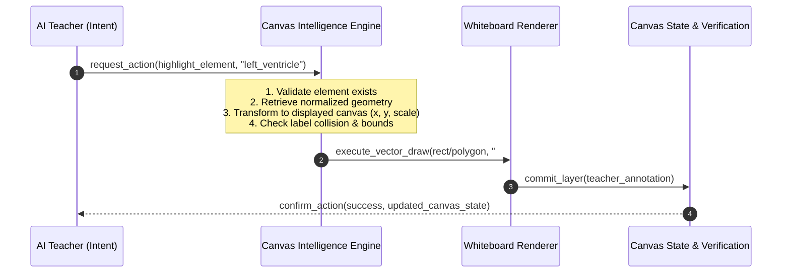

# Qrie Demo Class: Canvas Intelligence & Teaching Specification

> **Status:** Approved Architectural Specification  
> **Pilot Class:** Structure of the Human Heart & Double Circulation  
> **Target Engine:** Qrie Live Classroom Engine (Next.js 16 + SVG Vector Canvas)

---

## 1. System Vision & Core Architectural Decision

### 1.1 The Core Philosophy
The AI tutor must not treat a diagram as a static, opaque image. It must understand the diagram as a collection of **meaningful, addressable, and semantically connected elements**.

When teaching the Human Heart, the AI must explicitly know:
- The exact location, boundary, and dimensions of the `left_atrium`, `right_ventricle`, `aorta`, etc.
- Which valve connects which chamber (`tricuspid_valve` connects `right_atrium` to `right_ventricle`).
- The direction of blood flow (`superior_vena_cava` $\to$ `right_atrium` $\to$ `right_ventricle` $\to$ `pulmonary_artery`).
- Which action (highlight, circle, arrow, label) is pedagogically appropriate.

### 1.2 Separation of Pedagogical Intent from Geometric Calculation
**The LLM is NOT responsible for calculating raw drawing coordinates.** 

Instead, the system strictly follows a 4-step pipeline:



---

## 2. Data Structures & Data Contracts

### 2.1 Asset Canvas Map Schema (`AssetCanvasMap`)
Every visual asset in Qrie is accompanied by a structured asset map:

```typescript
export type ElementGeometryType = "box" | "polygon" | "path" | "point";

export type ElementGeometry = {
  type: ElementGeometryType;
  x: number;          // Normalized to asset width (0..1000)
  y: number;          // Normalized to asset height (0..1000)
  w: number;
  h: number;
  points?: [number, number][]; // For irregular anatomical chambers/polygons
  pathD?: string;              // For vessels and curved ducts
};

export type SemanticRelationship = {
  type: "connected_to" | "flows_to" | "valved_by" | "branches_into" | "separated_by";
  targetId: string;
  label?: string;
  notes?: string;
};

export type AllowedAction = 
  | "highlight" 
  | "circle" 
  | "box" 
  | "arrow" 
  | "pointer" 
  | "label" 
  | "underline" 
  | "annotate" 
  | "pulse";

export type CanvasElementDefinition = {
  elementId: string;
  name: string;
  category: "chamber" | "valve" | "vessel" | "septum" | "organelle" | "formula";
  scientificName?: string;
  geometry: ElementGeometry;
  relationships: SemanticRelationship[];
  labelsInAsset: { text: string; x: number; y: number }[];
  confidence: number;
  verificationStatus: "verified" | "tentative" | "unverified";
  allowedActions: AllowedAction[];
  pedagogicalNote: string;
};

export type AssetCanvasMap = {
  assetId: string;
  title: string;
  subject: string;
  source: string;
  naturalWidth: number;
  naturalHeight: number;
  elements: CanvasElementDefinition[];
};
```

---

## 3. The Canvas Intelligence Engine (CIE) API

The Canvas Intelligence Engine acts as the deterministic middleware between the AI tutor and the SVG whiteboard renderer.

```typescript
export interface ICanvasIntelligenceEngine {
  /** Returns the active canvas layout, visible assets, and active highlights */
  getCanvasState(): LiveCanvasState;

  /** Resolves an element by ID or natural language alias (e.g., "mitral valve" -> "bicuspid-valve") */
  findElement(elementIdOrAlias: string): CanvasElementDefinition | null;

  /** Converts asset-normalized coordinates into actual whiteboard stage coordinates (1000x330) */
  transformGeometry(element: CanvasElementDefinition, assetPlacement: AssetPlacement): CanvasBoundingBox;

  /** Validates an action before execution: checks visibility, asset scale, and collision with labels */
  validateAction(action: TeacherActionRequest): ValidationResult;

  /** Executes precise pedagogical actions anchored to verified element IDs */
  highlightElement(elementId: string, color?: string, style?: "fill" | "halo" | "box"): BoardMark[];
  circleElement(elementId: string, color?: string): BoardMark[];
  underlineElement(elementId: string, color?: string): BoardMark[];
  drawArrow(fromElementId: string, toElementId: string, color?: string, bidirectional?: boolean): BoardMark[];
  addAnnotation(elementId: string, text: string, placement?: "auto" | "top" | "bottom" | "side"): BoardMark[];
  addLabel(elementId: string, customLabel?: string): BoardMark[];
  eraseTeacherMark(markIdOrType: string): void;
}
```

---

## 4. Benchmark Pilot: Human Heart Demo Class

### 4.1 Addressable Anatomical Landmarks
The Human Heart diagram (`/assets/human-heart_med-removebg-preview.png`) is anchored on the board at $\{x: 580, y: 16, w: 270, h: 298\}$. The Canvas Intelligence Engine manages 14 verified landmarks:

| Element ID | Category | Connections / Relationships | Permitted Actions |
|---|---|---|---|
| `superior-vena-cava` | Vessel | `flows_to` $\to$ `right-atrium` | `highlight`, `arrow`, `label` |
| `inferior-vena-cava` | Vessel | `flows_to` $\to$ `right-atrium` | `highlight`, `arrow`, `label` |
| `right-atrium` | Chamber | `valved_by` $\to$ `tricuspid-valve`, `flows_to` $\to$ `right-ventricle` | `highlight`, `circle`, `pulse` |
| `tricuspid-valve` | Valve | `guards` $\to$ `right-ventricle` | `highlight`, `circle`, `annotate` |
| `right-ventricle` | Chamber | `valved_by` $\to$ `pulmonary-valve`, `flows_to` $\to$ `pulmonary-artery` | `highlight`, `circle`, `pulse` |
| `pulmonary-valve` | Valve | `guards` $\to$ `pulmonary-artery` | `highlight`, `circle` |
| `pulmonary-artery` | Vessel | `flows_to` $\to$ `lungs` | `highlight`, `arrow`, `label` |
| `pulmonary-veins` | Vessel | `flows_to` $\to$ `left-atrium` | `highlight`, `arrow`, `label` |
| `left-atrium` | Chamber | `valved_by` $\to$ `bicuspid-valve`, `flows_to` $\to$ `left-ventricle` | `highlight`, `circle`, `pulse` |
| `bicuspid-valve` | Valve | `guards` $\to$ `left-ventricle` | `highlight`, `circle`, `annotate` |
| `left-ventricle` | Chamber | `valved_by` $\to$ `aortic-valve`, `flows_to` $\to$ `aorta` | `highlight`, `circle`, `pulse` |
| `aortic-valve` | Valve | `guards` $\to$ `aorta` | `highlight`, `circle` |
| `aorta` | Vessel | `flows_to` $\to$ `systemic-body` | `highlight`, `arrow`, `label` |
| `septum` | Wall | `separated_by` between `right-ventricle` and `left-ventricle` | `highlight`, `underline` |

---

## 5. Teaching Sequence & Coordinated Timeline

### 5.1 The 4 Planned Segments

```
Segment 1: The Four Heart Chambers (00:00 - 00:28)
├── 00:00 - 00:09: Organ overview (Display Heart Diagram at 580,16)
├── 00:09 - 00:18: Right Atrium & Left Atrium (Highlight RA lilac, LA orange)
└── 00:18 - 00:28: Right Ventricle & Left Ventricle (Highlight RV sky, LV red)

Segment 2: Pathway to the Lungs (00:28 - 00:58)
├── 00:28 - 00:37: Vena Cava returns deoxygenated blood (Highlight SVC, IVC)
├── 00:37 - 00:47: Across Tricuspid Valve into RV (Draw Arrow RA -> RV, Circle Valve)
└── 00:47 - 00:58: Pulmonary Artery to Lungs (Arrow RV -> Pulm. Artery)

Segment 3: Systemic Flow to the Body (00:58 - 01:32)
├── 00:58 - 01:08: Pulmonary Veins return oxygenated blood (Highlight Pulm. Veins)
├── 01:08 - 01:20: Practice Checkpoint: "Which valve guards the LV?" (Display "?", Pause)
└── 01:20 - 01:32: Bicuspid Valve opens into LV -> Aorta (Arrow LV -> Aorta)

Segment 4: Double Circulation & Septum (01:32 - 02:00)
├── 01:32 - 01:42: Pulmonary vs Systemic circuits
├── 01:42 - 01:52: Interventricular Septum partition (Highlight Septum)
└── 01:52 - 02:00: Recap & Study Notes invitation
```

---

## 6. Interruption & Sentence-Boundary Continuity Protocol

When a student raises their hand or clicks the microphone during playback:

```
[Student Raises Hand]
         │
         ▼
[Sentence Boundary Engine]
  ├── Detect active audio cue in timeline
  ├── Determine timestamp of next punctuation mark (. ! ?)
  ├── Let teacher finish current sentence (0.4 - 1.2s)
  └── Smooth audio fade-out
         │
         ▼
[Pause & Context Snapshot]
  ├── Preserve exact pausedTimestamp
  ├── Preserve activeSegmentId ("segment_2_lungs")
  ├── Capture activeLandmark ("tricuspid-valve")
  └── Activate floating Doubt-Solving Banner on Whiteboard
         │
         ▼
[Student Asks Question]
  ├── Web Speech STT captures question
  └── AI Tutor receives [DOUBT-SOLVING MODE] with lectureContext
         │
         ▼
[AI Explains Doubt]
  ├── AI answers verbally + invokes CIE (e.g. highlight tricuspid valve)
  └── Marks rendered on ephemeral Doubt Layer
         │
         ▼
[Student Clicks "Resume Lecture"]
  ├── Clear ephemeral Doubt Layer
  ├── Restore pre-pause board state
  ├── Seek audio to pausedTimestamp
  └── Resume synchronized cue playback
```

---

## 7. Acceptance Criteria for Demo Class Completion

1. **Deterministic Element Addressing:** AI actions reference verified IDs (`"right-atrium"`), never guessed numeric coordinates.
2. **Coordinate Stability:** Moving or scaling the diagram automatically recalculates region highlights without manual offset math.
3. **Layer Independence:** Teacher highlights and student freehand drawings live in separate SVG layers. Erasing teacher marks never deletes student drawings.
4. **Sentence-Aligned Pausing:** Interruption allows the current sentence to complete naturally without jarring mid-word cutoffs.
5. **Exact Resumption:** Resuming returns to the paused timestamp with all cues, audio, and drawings 100% in sync.
